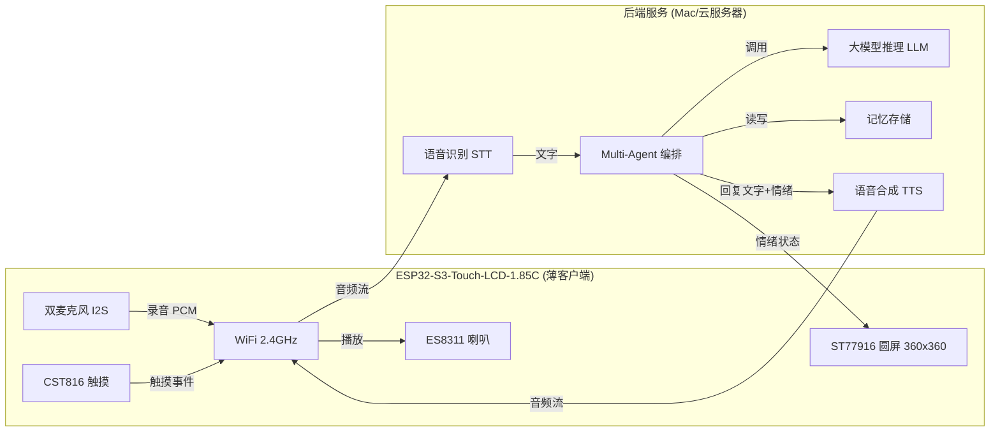
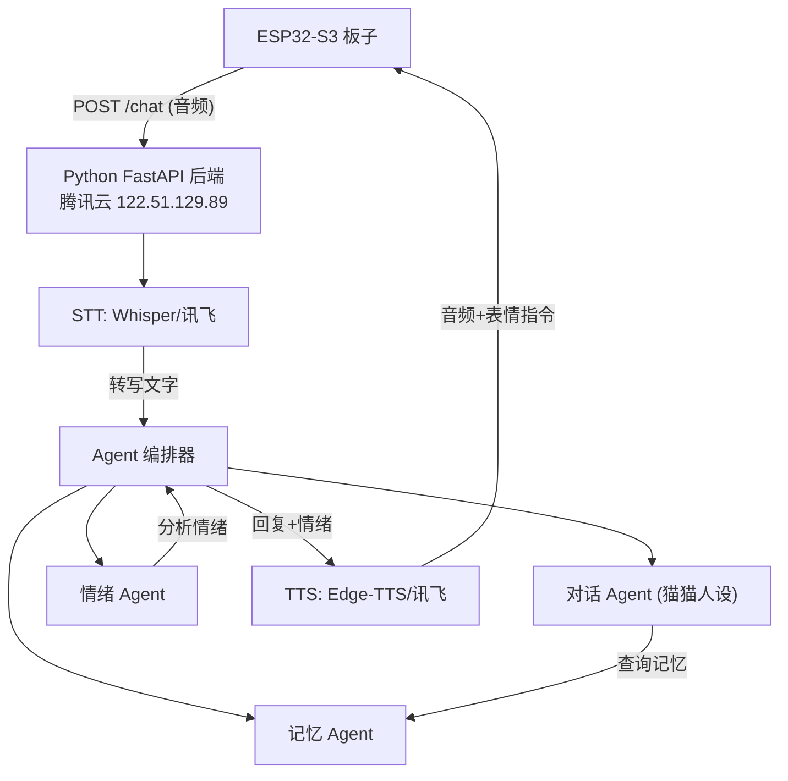

# Cyber Cat - AI 陪伴猫

基于微雪 ESP32-S3-Touch-LCD-1.85C 一体板 + 云端 AI，打造一只有表情、能听说、有记忆的 AI 陪伴猫。

ESP32-S3 作为薄客户端负责音频采集/播放和表情显示，所有 AI 推理通过云端完成。

## 硬件：微雪 ESP32-S3-Touch-LCD-1.85C **V2** 一体板

不需要任何接线！以下所有外设全部板载集成：

| 模块 | 芯片/型号 | 接口 & 引脚 |
|------|-----------|-------------|
| 主控 | ESP32-S3R8 | 双核 240MHz, 512KB SRAM, 8MB PSRAM, 16MB Flash |
| 屏幕 | ST77916, 1.85寸圆形 360x360, 262K色 | QSPI: SDA0=GPIO46, SDA1=GPIO45, SDA2=GPIO42, SDA3=GPIO41, SCK=GPIO40, CS=GPIO21, TE=GPIO18, RST=EXIO2, BL=GPIO5 |
| 触摸 | CST816 | I2C: SDA=GPIO11, SCL=GPIO10, INT=GPIO4, RST=EXIO1 |
| 音频 DAC (喇叭) | **ES8311** | 共享 I2S 总线, I2C 配置 |
| 音频 ADC (麦克风) | **ES7210** + 双模拟麦克风 | 共享 I2S 总线, I2C 地址 0x40 |
| 共享 I2S 总线 | — | MCLK=GPIO2, BCK=GPIO48, LRCK=GPIO38, DIN(mic)=GPIO39, DOUT(spk)=GPIO47 |
| 功放控制 | NS4150B | PA_CTRL=GPIO15 |
| GPIO 扩展器 | TCA9554PWR | I2C: 控制 LCD_RST, TP_RST, SD_CS 等 |
| 陀螺仪/加速度计 | QMI8658 | I2C: SCL=GPIO10, SDA=GPIO11, INT1=EXIO5, INT2=EXIO4 |
| RTC 时钟 | PCF85063 | I2C: SCL=GPIO10, SDA=GPIO11, INT=GPIO9 |
| SD 卡 | Micro SD 卡槽 | SD: MISO=GPIO16, MOSI=GPIO17, SCK=GPIO14, CS=EXIO3 |
| 电池管理 | 支持 3.7V 锂电池充放电 | MX1.25 2PIN 接口 |
| 其他 | 音量调节旋钮, USB Type-C, RESET/BOOT 按键 | - |

> **注意**: 本项目适配 **V2 版** 硬件。V1 版使用 PCM5101 DAC + MEMS 数字麦克风，引脚映射不同（V1 已于 2026.1.30 停产）。

**官方参考代码**：[waveshareteam/ESP32-S3-Touch-LCD-1.85C](https://github.com/waveshareteam/ESP32-S3-Touch-LCD-1.85C)

## 整体架构



## 云端 API 方案

| 能力 | 首选方案 | 备选方案 | 说明 |
|------|----------|----------|------|
| LLM（大脑） | 通义千问 qwen-turbo | DeepSeek / GPT-4o | OpenAI 兼容接口，国内直连，速度快 |
| STT（语音转文字） | SiliconFlow SenseVoiceSmall | 讯飞 STT | Whisper 兼容接口，中文识别优秀 |
| TTS（文字转语音） | SiliconFlow CosyVoice2-0.5B | 讯飞 TTS | OpenAI 兼容接口，WAV 输出，与 STT 同一 API Key |

## 开发路线

### Phase 1: 硬件基础 - "让猫睁开眼睛" (已完成 2025-04-04)

**目标**：验证所有硬件能正常工作，跑通微雪官方驱动

- [x] 修改 `platformio.ini`：配置 ESP32-S3R8 参数（PSRAM、Flash、分区表等）
- [x] 连接 WiFi 并在串口打印 IP 地址
- [x] 移植微雪官方 ST77916 + TCA9554PWR 驱动，点亮圆屏
- [x] 集成 LVGL 图形库，在圆屏上显示内容
- [x] 测试 I2S 双麦克风录音（串口打印音量值）
- [x] 测试 I2S 音频播放（V2: ES8311 DAC + NS4150B 功放）
- [x] 测试 CST816 触摸事件

**完成总结**：

使用 pioarduino 平台（Arduino ESP32 v3.1.3 + ESP-IDF 5.3），从微雪 GitHub 仓库移植全套驱动到 `lib/waveshare/`，集成 LVGL v9.3 图形库。`src/main.cpp` 按顺序初始化 I2C、屏幕、LVGL、WiFi、I2S 音频，创建测试 UI 显示 WiFi 状态、触摸坐标和麦克风音量，启动时播放 beep 提示音。所有板载硬件验证通过。

| 模块 | 验证结果 |
|------|----------|
| I2C + TCA9554PWR | OK |
| ST77916 圆屏 (QSPI 80MHz) | OK |
| CST816 触摸 (ChipID: 0xB5) | OK |
| LVGL v9.3 UI | OK |
| WiFi 2.4GHz | OK (需打开 iPhone 热点"最大兼容性") |
| I2S 麦克风 (16kHz/16bit, V2: ES7210 + 双模拟麦) | OK |
| I2S 喇叭 (V2: ES8311 DAC + NS4150B 功放) | OK |

**踩坑记录**：
- PlatformIO 默认 `espressif32` 平台用的是 ESP-IDF 4.4，微雪驱动需要 ESP-IDF 5.x，需切换到 pioarduino 平台
- 从 GitHub 通过 WebFetch 下载的 `.h/.c` 文件中，尖括号 `<>` 的 include 会被 markdown 解析吞掉，需手动修复（如 `lv_conf.h` 中的 `<stdint.h>` 等）
- iPhone 热点默认用 5GHz，ESP32 只支持 2.4GHz，需打开"最大兼容性"

**关键驱动文件**（位于 `lib/waveshare/`，从微雪官方示例移植）：

| 文件 | 用途 |
|------|------|
| `Display_ST77916.h/.cpp` | ST77916 QSPI 屏幕驱动 |
| `esp_lcd_st77916.h/.c` | ESP-IDF LCD 底层驱动 |
| `TCA9554PWR.h/.cpp` | GPIO 扩展器驱动 |
| `Touch_CST816.h/.cpp` | 触摸屏驱动 |
| `I2C_Driver.h/.cpp` | I2C 通信封装 |
| `LVGL_Driver.h/.cpp` | LVGL 对接层 |

### Phase 2: 猫脸表情系统 - "让猫有表情" (已完成 2026-04-07)

**目标**：在 360x360 圆屏上用 LVGL 显示可切换的猫脸表情

- [x] 极简风格：纯黑背景 + 两只白色大圆眼睛，纯靠眼睛形状变化传达情绪
- [x] 实现 6 种核心表情：Neutral / Happy / Listening / Thinking / Sleepy / Talking
- [x] 动画系统：自动眨眼（4~10s 随机间隔）、说话时眼睛律动、待机随机看向
- [x] 触摸交互：点击→开心 2s、长按→触发 AI 对话、待机 120s→自动进入 Sleepy
- [ ] 利用 QMI8658 陀螺仪：摇晃板子触发晕眩表情（留到 Phase 6）

**完成总结**：

采用极简机器人/数码宠物风格——深色背景上两只白色大圆眼睛，所有情绪通过眼睛的尺寸、形状、位置、旋转来表达，没有任何额外 UI 元素。每只眼睛是一个 `lv_obj`，通过 `EyeState{cx, cy, w, h, rot}` 参数化控制。CST816 硬件手势检测驱动触摸交互（点击/长按）。

| 表情 | 眼睛效果 | 参数 (w×h, rot) |
|------|----------|-----------------|
| Neutral | 两个大白圆 ○ ○ | 95×95, 0° |
| Happy | 柔和眯眼 + 猫咪慢眨眼 | 95×55, 0°, Y-5；慢眨眼 350ms闭/400ms开 |
| Listening | 双眼放大、略不对称，锁定凝视 + 轻微 pulse | 左 118×118 / 右 110×110, 0°；固定凝视（不看向）|
| Thinking | 双眼微眯外偏 + 轻微向外旋转 | 88×78, ±5°；保留慢速随机凝视（减小幅度）|
| Sleepy | 极细线 | 80×8, 0° |
| Talking | 4 段循环律动（见下） | 圆眼挤压/拉伸节奏 |

**脸部布局**（360×360 圆屏）：

- 眼睛直径 95px，左眼中心 (113, 135)，右眼中心 (247, 135)
- 间距 134px，整体偏上以配合圆屏弧度
- 视觉层次：白色眼睛 (#ffffff) 100% 不透明，深色背景 (#0a0a1a)，无其他 UI 元素

**动画系统**（基于 LVGL `lv_anim_t`，全部自驱动无需手动轮询）：

| 动画 | 时长 | 缓动曲线 | 说明 |
|------|------|----------|------|
| 表情切换 | 350ms | ease_in_out | 所有 5 个属性同时插值过渡 |
| 普通眨眼 | 100ms 闭 + 120ms 开 | ease_out | 4~10s 随机间隔自动循环 |
| Happy 慢眨眼 | 350ms 闭 + 400ms 开 | ease_in_out | 2.5~5s 间隔；高度压缩至 4px 薄线 |
| Listening 脉冲 | 150ms 缩 + 200ms 开 | ease_in_out | 0.6~0.9s 间隔；缩至 ~70/65px（~40% 幅度）|
| 待机看向 | 250ms 移 + 1s 停 + 250ms 回 | ease_in_out | 3~6s 随机间隔；Thinking 时幅度减半 |
| Talking 律动 | 4 段循环，总周期 ~450ms | 各段独立 | 无限循环，见下表 |

**Talking 眼睛律动（4 段 squeeze/unsquash 循环）**：

说话时眼睛进入无限重复的 4 段律动，通过挤压-拉伸-过冲-归位表现"在说话"的生命感，而非依赖外加嘴部控件：

| 段 | 描述 | 目标尺寸 | 旋转 | cy 偏移 | 时长 | easing |
|----|------|----------|------|---------|------|--------|
| 0 | 挤压上提 | 100×60 | ±10° | -10px | 100ms | ease_out |
| 1 | 展开下沉 | 95×95 | ±5° | +10px | 150ms | ease_out |
| 2 | 轻微过冲 | 98×98 | 0° | 0 | 100ms | ease_in_out |
| 3 | 归位 neutral | 95×95 | 0° | 0 | 100ms | linear |

律动在表情 morph（350ms）完成后启动，避免与入场动画打架。切换到其他表情时律动立即停止，通过 epoch 计数器保证无残留回调。

**Happy 猫咪慢眨眼（Slow Blink）原理**：猫行为学中，慢眨眼是信任和愉悦的信号。实现方式：基础状态为柔和眯眼（95×55，Y 上移 5px），在此基础上以 350ms 缓慢闭合（纯高度压缩至 4px 薄线），400ms 缓慢睁开恢复。间隔 2.5~5s 重复，用 ease_in_out 曲线保持柔和慵懒的节奏。Happy 状态下停止随机看向，保持满足的凝视。

**渲染管线**：

```
表情插值 (exprProgress 0→1000)
  → 叠加眨眼（纯高度压缩）
  → 叠加看向偏移（Talking/Listening 时固定 0）
  → _placeEye() 写入 lv_obj

Talking 额外层：
  talk exec_cb 直接调用 _placeEye()（绕过 render 管线的 lerp）
  右眼 done_cb 作为 master 推进 stage → (stage+1) % 4
```

切换表情时取消所有动画（expr/blink/look/talk），从当前插值状态平滑过渡到新目标，支持中途打断无跳变。开机时眼睛从 0px 渐大到正常尺寸（pop-in 效果）。

**性能配置**：

- LVGL 刷新率：`LV_DEF_REFR_PERIOD = 16ms`（~60fps）
- LVGL 任务轮询间隔：16ms（与刷新率对齐，避免 Core0 空转）
- LVGL heap：64KB 分配在 PSRAM，释放内部 SRAM 供系统使用
- `LV_DRAW_LAYER_MAX_MEMORY = 32KB`（防止复杂 layer 渲染 OOM）

**状态机**：

| 状态 | 触发条件 | 退出条件 |
|------|----------|----------|
| Neutral | 开机 / AI 回复 / 唤醒后 | 点击→Happy、长按→AI 对话、120s 无操作→Sleepy |
| Happy | 点击（非 Sleepy 时）| 2 秒后自动恢复前一状态 |
| Listening | 长按进入录音 | VAD 静音 / 点击停止→Thinking；再次长按→取消→Neutral |
| Thinking | 音频录制完成，等待 AI | AI 回复/报错→Neutral |
| Sleepy | 待机 120s 无触摸 | 点击→Neutral、长按→Neutral + 触发 AI 对话 |
| Talking | AI 回复后自动进入，TTS 播放期间 | TTS 播放完毕/报错/30s 超时→Neutral |

**触摸交互**：

| 手势 | 当前状态 | 效果 |
|------|----------|------|
| 点击 | 非 Sleepy / 非录音 | 切换到 Happy，2 秒后恢复 |
| 点击 | Sleepy | 唤醒到 Neutral |
| 点击 | Listening（录音中）| 提前结束录音 → THINKING |
| 长按 | 任意（非录音）| 唤醒（如 Sleepy）→ 进入录音 LISTENING |
| 长按 | Listening（录音中）| 取消录音 → IDLE |

**关键文件**：

| 文件 | 用途 |
|------|------|
| `src/cat_face.h` | CatExpression 枚举（6种）+ CatFace 类声明（含 EyeState + TapCb + lastInteractMs） |
| `src/cat_face.cpp` | 极简猫脸绘制、6种核心表情、动画引擎、Talking 律动、触摸/状态机交互 |

**踩坑记录**：
- **LVGL 触摸回调清除手势数据**：微雪的 `LVGL_Driver.cpp` 中 `my_touchpad_read` 每次读完触摸数据后会把 `touch_data.gesture` 清零为 `NONE`，导致主循环里永远读不到手势。修复：去掉 gesture 清零；同时让 `Touch_Read_Data()` 始终更新 gesture（包括 0x00=NONE），使手势结束后自然回到 NONE
- **I2S 麦克风时钟串扰导致喇叭蜂鸣**：`mic_i2s_init()` 后 I2S 外设通过 DMA 持续在 SCK/WS 引脚产生高频时钟信号，在紧凑 PCB 上通过电磁耦合串扰到 PCM5101 DAC 音频输出通路，喇叭放大为可听见的蜂鸣声。修复：Phase 2 不需要音频时，不初始化任何 I2S 驱动，并将全部 6 个音频 I2S 引脚主动拉低
  - **Phase 4 实际方案**：V2 板 ES7210 需要持续 MCLK，I2S 不再启停。改用 PA 控制引脚（GPIO15）在录音期间拉低静音功放，彻底避免喇叭输出干扰
- **LVGL CAT_SLEEPY blink 死循环**：Sleepy 时 `_blinkAnimCb` 直接 return 跳过渲染，但 `_blinkDoneCb` 不检查 `_cur`，持续重新调度无效动画积累 heap 碎片。修复：`_scheduleBlink()` 加 `CAT_SLEEPY` 和 `CAT_TALKING` guard；done_cb 加 epoch 校验防止 `_apply()` 后的残留回调重新调度

### Phase 3: 云端通信 - "让猫联网" (已完成 2026-04-06)

**目标**：ESP32-S3 能通过 HTTPS 调用云端 LLM API

- [x] 封装 HTTP 客户端（HTTPS + JSON，通义千问 OpenAI 兼容接口）
- [x] 实现 WiFi 自动重连机制（断开后每 10s 重试 + 事件回调）
- [x] 测试调用 LLM API（长按触发对话，猫保持当前表情静默等待，回复后恢复 Neutral）
- [x] WiFi 凭证和 API Key 安全存储（`secrets.h` + `.gitignore`）
- [x] 全面稳定性和性能修复（见下）
- [ ] 可选：用 SD 卡缓存大音频文件（暂不需要，PSRAM 8MB 足够流式处理）

**完成总结**：

采用 FreeRTOS 后台 task 架构实现非阻塞 API 调用——主循环保持 LVGL 动画流畅运行，HTTP 请求在独立 task 中执行（绑定 Core 1，避免与 Core 0 LVGL/WiFi 中断争用）。通义千问 qwen-turbo 模型通过 OpenAI 兼容接口调用，响应体采用流式 JSON 解析（`deserializeJson(doc, http.getStream())`）避免中间 String 拷贝。WiFi 管理模块从 `main.cpp` 抽取为独立组件，支持事件驱动的状态跟踪和自动重连。

**交互流程**：

```
长按屏幕（如 Sleepy 则先唤醒到 Neutral）
  → 猫保持当前表情 → FreeRTOS task 静默发送 HTTPS POST
  → 通义千问回复 → 回到 Neutral + Serial 打印回复（Phase 5 由 AI 情感驱动表情）
  → 失败（超时/API 错误） → 回到 Neutral + Serial 打印错误
  → 无 WiFi → 请求直接失败，猫不作额外反应
```

**架构设计**：

| 组件 | 职责 |
|------|------|
| `wifi_manager` | WiFi 连接/重连/状态跟踪，事件回调驱动 |
| `cloud_client` | 通义千问 API 封装，FreeRTOS task 异步执行，主循环轮询结果 |
| `secrets.h` | WiFi 凭证 + API Key，gitignored 不入版本控制 |

**API 规格**：

- 通过 `secrets.h` 中的 `LLM_API_BASE`、`LLM_API_KEY`、`LLM_MODEL` 配置
- 支持任何 OpenAI 兼容接口（通义千问 / DeepSeek / OpenAI / MiniMax 等）
- System prompt：猫咪人设（简短回复 + 拟声词）
- 超时：15s，响应缓冲区 1KB (PSRAM)，Chat worker 栈 16KB，STT worker 栈 32KB，均绑定 Core 1

**稳定性与性能修复（本阶段系统性 review 结果）**：

| 类别 | 问题 | 修复 |
|------|------|------|
| Critical | CST816 `Touch_interrupts` 缺 `volatile`，编译器优化下任务侧永远读不到 ISR 写入 | 加 `volatile`；统一 ISR 宏为 `IRAM_ATTR` |
| Critical | Cloud worker task 栈 8KB，TLS 握手峰值 6~10KB，大概率溢出崩溃 | 栈扩大到 16KB；`xTaskCreate` → `xTaskCreatePinnedToCore(..., 0)` |
| Critical | `ESP_PANEL_HOST_SPI_MAX_TRANSFER_SIZE 2048` 远小于 partial buffer（25920 字节），flush 被拆分为数十笔事务 | 改为 `LCD_WIDTH × LCD_HEIGHT × 2`（259200） |
| Major | `CloudState _state` 用 `volatile`，Xtensa LX7 双核不保证 store-buffer 刷新顺序 | 改为 `std::atomic<CloudState>`，provides happens-before 语义 |
| Major | `http.getString()` 在 DRAM heap 制造完整响应副本，API 错误时可能 OOM | 改为流式解析 `deserializeJson(doc, http.getStream())`；加响应大小上限检查 |
| Major | LVGL task 每 5ms 唤醒，但刷新周期 16ms，约 60% 唤醒是空转占用 Core0 | task delay 改为 16ms |
| Major | LVGL 64KB heap 静态占用内部 SRAM | 通过 `LV_MEM_POOL_ALLOC = ps_malloc` 迁到 PSRAM |
| Major | `_blinkDoneCb` / `_lookDoneCb` 可在 `lv_anim_delete` 后仍被派发，导致双重调度 | 引入 `_animEpoch` 计数器，done-cb 校验 epoch，不匹配则丢弃 |

**关键文件**：

| 文件 | 用途 |
|------|------|
| `src/wifi_manager.h/.cpp` | WiFi 连接管理 + 自动重连 |
| `src/cloud_client.h/.cpp` | 通义千问 API 客户端（异步，Core 1 绑定） |
| `src/secrets.h` | WiFi/API 凭证（gitignored） |
| `src/secrets.h.example` | 凭证模板（入 Git） |

**已知待处理**（不影响当前功能，Phase 4 前修复）：
- `touch_data` 跨核访问（LVGL task 写 / loop task 读）无 mutex 保护
- HTTPS 使用 `setInsecure()`，生产环境需替换为根证书校验
- LCD flush callback 中 CPU 逐像素做字节序 swap，建议改为 DMA 异步完成回调

### Phase 4: 语音管道 - "让猫能听能说" (进行中 2026-04-08)

**目标**：实现完整的 语音输入 -> STT -> AI 回复 -> TTS 语音输出 链路

- [x] 双麦克风 I2S 录音（16kHz 16bit mono PCM，PSRAM 缓冲最长 30s）
- [x] 实现 VAD（语音活动检测）：RMS 能量检测，2s 静音自动停止，300ms 最短语音防误触
- [x] PA 控制静音：录音期间 GPIO15=LOW 关闭功放，避免喇叭串扰（V2 I2S 持续运行供 ES7210 MCLK）
- [x] 对话状态机（IDLE → LISTENING → THINKING → TALKING → IDLE）集成到主循环
- [x] 触摸控制：长按开始录音，点击提前结束，再次长押取消
- [x] 新增 CAT_LISTENING / CAT_THINKING / CAT_TALKING 表情联动
- [x] **STT 音频上传**：PCM → 设备端构建 WAV 头 → multipart POST → SiliconFlow STT → transcript 自动喂给 LLM
- [x] **屏幕底部对话条幅**：自定义 GB2312 CJK 字体（3766 字），显示 `[你] 识别文字` 和 `[猫] AI 回复`，按圆屏弦宽定位（240px 宽，y≈300）
  - [ ] 字幕打印后不会消失（应在下次录音开始或超时后自动清除）
  - [ ] 出现/消失动画（渐显渐隐或滑入滑出）
- [x] **WDT 崩溃修复**：HTTP worker 绑 Core 1 + 关闭 IDLE 任务 WDT 监控（见踩坑）
- [x] **TTS 语音合成播放**：AI 回复文字 → SiliconFlow CosyVoice2 → WAV → ES8311 DAC → 喇叭（已验证端到端播放）
  - ES8311 I2C 寄存器序列经多轮排查修正（见踩坑记录）
  - mono→stereo 转换、PA 控制（GPIO15）、DMA 清零、partial write 重试
  - 音量 API：`es8311SetVolume(0–100)`，TTS 播放期间临时提升到 70%，播放完恢复用户设定值
  - 调试工具：`TTS_DUMP_SERIAL=1` 可 hex dump WAV 到串口，配套 Python 脚本还原为 `.wav` 文件
  - 硬件自检：`es8311Beep(freq, duration)` 生成正弦波测试喇叭
- [ ] 删除 `flush_skip` / `touch_skip` 机制，让 LVGL 在 THINKING/TALKING 期间正常渲染（Thinking 动画流畅化）
- [ ] 音量旋钮控制播放音量

**已完成部分总结**：

V2 板使用 **ES7210 音频 ADC** + 双模拟麦克风，通过共享 I2S 总线采集音频。`es7210_mic.h/.cpp` 实现了 ES7210 的 I2C 寄存器初始化（遵循 Waveshare 官方 `08_esp_sr` 示例的寄存器序列），`audio_input.h/.cpp` 基于遗留 `driver/i2s.h` API 实现录音驱动和 VAD 逻辑。`cloud_client` 新增 STT + TTS 流水线：录音结束后，设备端在 PSRAM 中拼装 44 字节 WAV 头 + PCM 数据，以 `multipart/form-data` 格式 POST 到 SiliconFlow STT，收到 transcript 后自动发起 LLM chat，AI 回复后再调用 SiliconFlow CosyVoice2 TTS 下载 WAV 并通过 ES8311 DAC 播放。整个流程（STT→LLM→TTS→播放）在 Core 1 的独立 FreeRTOS task 中异步完成，主循环只需轮询 `cloud.poll()`。屏幕底部新增 CJK 条幅，STT 完成后显示 `[你]`，AI 回复后切换显示 `[猫]`。

**对话交互流程（当前）**：

```
长按  → LISTENING（VAD 监听，猫切 Listening 表情）
  自动/点击停止 → THINKING（猫切 Thinking，屏幕显示 [你] transcript）
  → PCM → WAV → SiliconFlow STT → transcript → LLM chat
  → AI 回复 → TALKING（猫切 Talking 眼睛律动，屏幕显示 [猫] 回复）
  → TTS 下载 WAV → ES8311 播放完毕 → IDLE（猫切 Neutral）
  再次长按（录音中）→ 取消，回到 IDLE
```

**VAD 参数**（`audio_input.h`，可按实测麦克风调整）：

| 参数 | 值 | 说明 |
|------|----|------|
| `VAD_RMS_THRESHOLD` | 400 | 高于此 RMS = 有声音 |
| `VAD_SILENCE_MS` | 2000ms | 持续静音超过此时长 → 自动停止 |
| `VAD_MIN_SPEECH_MS` | 300ms | 最短有效语音，防止误触发 |
| `AUDIO_MAX_SECONDS` | 30s | 最长录音，超限强制停止 |

**STT / LLM / TTS API 配置**（`secrets.h`）：

| 宏 | 说明 |
|----|------|
| `LLM_API_BASE` | LLM 接口基地址（通义千问 / DeepSeek / OpenAI 等） |
| `LLM_API_KEY` | LLM API Key |
| `LLM_MODEL` | 模型名，如 `qwen-turbo` |
| `STT_API_BASE` | STT 接口基地址（如 `https://api.siliconflow.cn/v1`） |
| `STT_API_KEY` | STT API Key（SiliconFlow 等） |
| `TTS_API_BASE` | TTS 接口基地址（如 `https://api.siliconflow.cn/v1`） |
| `TTS_API_KEY` | TTS API Key（可与 `STT_API_KEY` 相同） |
| `TTS_MODEL` | TTS 模型名，如 `FunAudioLLM/CosyVoice2-0.5B` |
| `TTS_VOICE` | 音色名，如 `FunAudioLLM/CosyVoice2-0.5B:alex` |

STT 模型固定为 `FunAudioLLM/SenseVoiceSmall`（`cloud_client.cpp` 中修改）。TTS 返回 WAV 格式（`response_format=wav`，16kHz），设备端直接流式写入 ES8311 播放，最大缓冲 500KB（约 15s）。

**V2 板 ES7210 + ES8311 音频架构**：

```
Wire.begin() → es7210Init(16000)     → i2s_driver_install(RX+TX) → i2s_set_pin()
  ↓                ↓                         ↓                          ↓
 I2C 总线      ES7210/ES8311          遗留 I2S 驱动              MCLK/BCK/LRCK
              寄存器配置              (全双工 RX+TX)              DIN=GPIO39 (录音)
              (无需时钟)              (避免 GDMA 问题)            DOUT=GPIO47 (播放)

录音时：PA_CTRL=LOW → audioInputProcess() → PCM → STT
播放时：es8311Init() → PA_CTRL=HIGH → i2s_write(stereo) → PA_CTRL=LOW
```

| 配置项 | 值 | 说明 |
|--------|----|------|
| I2S 驱动 | 遗留 `driver/i2s.h` | 新标准驱动在 PSRAM(qio_opi) 下有 GDMA 兼容问题 |
| I2S 模式 | RX + TX 全双工 | 录音(DIN=GPIO39) 与播放(DOUT=GPIO47) 共用同一 I2S_NUM_0 实例 |
| 采样率 | 16kHz | MCLK = SR × 256 = 4.096MHz |
| 位深 | 16-bit stereo | 录音提取左声道(MIC1) mono；播放将 mono WAV 复制 L=R |
| ES7210 模拟增益 | 24dB (0x18) | 36dB 在近距离导致 ADC 饱和（0x7FFF 削波） |
| ES7210 数字音量 | 0dB (0xBF, 默认) | +32dB 与高增益叠加会严重削波 |
| ES8311 用户音量 | 20%（REG32=0x33） | `es8311SetVolume(20)` 设定基准；TTS 播放时临时 70%，完毕恢复 |
| TTS 缓冲 | 500KB PSRAM | 约 15s @16kHz 16-bit mono，heap_caps_malloc 从 SPIRAM 分配 |
| PA 控制 | GPIO15 HIGH/LOW | 播放前 HIGH（10ms 上电），播放完 LOW + 80ms drain 防 pop 音 |

**踩坑记录**：

- **ES7210 麦克风全零数据（V2 板最大坑）**：V2 板的麦克风不是 V1 的直连 MEMS 数字麦，而是通过 ES7210 ADC 芯片采集的双模拟麦克风。调通过程经历了多轮排查：
  1. **REG01 时钟关闭未恢复（根因）**：最初的 ES7210 初始化代码参考了 Espressif 开源驱动，在配置阶段写入 `REG01=0x3F` 关闭所有内部时钟，但**后续从未恢复**。对照 [Waveshare 官方 `08_esp_sr` 示例](https://github.com/waveshareteam/ESP32-S3-Touch-LCD-1.85C/tree/main/Arduino/examples/08_esp_sr) 后发现官方代码**根本不写 REG01**。移除此行后数据立即正常
  2. **新 I2S 标准驱动 GDMA/PSRAM 冲突**：尝试使用 ESP-IDF 5.x 新的 `i2s_std.h` 驱动（含 Arduino `ESP_I2S.h` 封装），但在 PSRAM（qio_opi 模式）下 `i2s_channel_init_std_mode` 报错 `user context not in internal RAM`——GDMA 要求回调上下文在内部 SRAM，而 PSRAM 分配器将 I2S 内部结构放到了外部内存。该 SDK 配置在 Arduino 预编译框架下无法轻易修改，最终**回退到遗留 `driver/i2s.h` API**（不依赖 GDMA）解决
  3. **初始化顺序**：Waveshare 官方先配 ES7210 寄存器（I2C 不依赖时钟），再启动 I2S 提供 MCLK/BCK/LRCK。最终采用此顺序
  4. **增益与音量**：官方示例使用 36dB 模拟增益 + +32dB ADC 数字音量，但实测该组合在近距离说话时导致严重 ADC 饱和（采样值恒为 0x7FFF），VAD 永远检测不到静音，录音无法自动停止。最终降至 24dB 模拟增益 + 0dB 数字音量解决
  5. **录音卡住（ADC 削波 → VAD 失效）**：36dB+32dB 增益组合下，即使中等音量也会让 ADC 全程饱和，RMS 始终远超 `VAD_RMS_THRESHOLD`，`_silenceStartMs` 不断重置，录音永远不会自动结束。修复：降低增益 + 在 `audioInputProcess()` 中加入 `AUDIO_MAX_SECONDS` 硬时间限制强制停止
- **WDT 崩溃（Core 0 IDLE 饥饿）**：最初 HTTP worker task 绑定 Core 0，与 LVGL Loop 争核，导致 5 秒内 IDLE0 无法执行，看门狗触发重启。**第一步修复**：将 STT/Chat worker task 改为绑 Core 1（`xTaskCreatePinnedToCore(..., 1)`），栈从 16KB 扩至 32KB（TLS + 245KB 请求体需要更多栈）。**第二步修复**：TLS 上传期间 WiFi 驱动中断回调强制跑在 Core 0，导致 IDLE0 仍偶发饥饿；在 `setup()` 中调用 `esp_task_wdt_reconfigure()` 将 `idle_core_mask` 设为 0（停止监控 IDLE 任务），超时改为 30s。IDLE 饥饿在重度网络 I/O 期间是正常现象，无需 WDT 为此重启。
- **LVGL 渲染器死循环（对话后 UI 卡死的根因）**：对话完成后 UI 完全冻结——表情不回 Neutral、字幕不显示、触摸无响应。经过多轮诊断定位出**两个协同问题**：
  1. **`lv_timer_handler()` 无限重绘循环**：当 `_flush_skip=true` 导致 flush callback 瞬间完成（跳过 SPI 传输），LVGL display refresh timer 内部循环不断发现脏区域→渲染→瞬间 flush→发现新脏区域→永远不退出。这使 LVGL 任务卡死在单次 `lv_timer_handler()` 调用中。**修复**：skip mode 下完全跳过 `lv_timer_handler()`，LVGL callback 仍正常运行以缓存 UI 更新，恢复 normal mode 时一次性渲染
  2. **跨核竞态条件**：主循环（Core 1）在 `enterThinking()` 中设置 `_flush_skip=true` 时，LVGL 任务（Core 0）可能正在执行 `lv_timer_handler()`。标志在渲染中途变化会触发上述无限循环。**修复**：使用 `lvgl_port_lock()` 屏障——先获取 LVGL 互斥锁（等待当前渲染完成），在锁内设置 skip 标志，再释放锁。保证标志只在两次 LVGL 迭代之间改变

- **ES8311 DAC 无声音输出（仅功放 "咚" 一声）**：调用 `es8311Play()` 后喇叭仅在 PA 上电时震动一下，无实际语音播放。根因是 ES8311 I2C 寄存器初始化序列存在多处缺失/错误：
  1. **REG0x00 缺少 power-on 命令（0x80）**：soft reset 后只写了 0x1F→0x00，缺少最后的 0x80 power-on，芯片未真正启动
  2. **REG0x09/0x0A SDP 格式未配**：Serial Data Port 的输入/输出格式寄存器完全没写，导致 I2S 数据格式不匹配（16-bit 需写 0x0C）
  3. **REG0x0E=0xA0（错误）→ 0x02**：模拟通路配置错误，部分模拟模块未正确使能
  4. **REG0x13=0x00（根因之一）→ 0x10**：HP 驱动输出使能位为 0 = 静音，这是最直接的无声根因
  5. **REG0x37=0x48（错误）→ 0x08**：DAC 均衡器旁路和 fade-rate 位配置错误
  6. **REG0x01=0x30 → 0x3F**：内部时钟门控未全开，部分模块时钟被关断

  修复方法：对照 Espressif ESP-ADF `es8311.c` 参考驱动 + 数据手册逐寄存器比对。教训：音频编解码器的 I2C 寄存器初始化**必须对照官方参考驱动逐个验证**，一个位错误就可能导致完全静音
- **CJK 字体方框问题**：LVGL 内置 `lv_font_simsun_16_cjk` 仅含 1000 个常用部首，大量日常汉字（如"猫""你""喵"等）不在其中，渲染为方框 □。**修复**：用 [lv_font_conv](https://lvgl.io/tools/fontconverter) 从 STHeiti.ttf 生成自定义字体 `lv_font_chinese_16`，覆盖 GB2312 一级 3766 字 + CJK 标点 + 全角 ASCII，4bpp 16px，编译后增加约 320KB Flash。`chat_ticker.cpp` 中用 `stripEmoji()` 过滤 4 字节 UTF-8 序列（emoji 等），防止超出字体覆盖范围的字符显示为方框。

**常驻诊断框架**（Phase 4 调试 LVGL 死循环后建立，永久保留）：

| 机制 | 位置 | 说明 |
|------|------|------|
| 周期性健康报告 | `main.cpp` loop 末尾 | 每 10s 打印 `[Health] main=N lvgl=N heap=N ds=X wifi=X`，一行总览双核循环计数、剩余堆内存、对话状态、WiFi 状态 |
| LVGL 心跳计数器 | `LVGL_Driver.cpp` | `_lvglLoopCount` 每次 LVGL 循环 +1，通过 `lvgl_get_loop_count()` 暴露给主循环。健康报告中若计数停止增长 = Core 0 卡死 |
| `lv_timer_handler` 超时 guard | `LVGL_Driver.cpp` | 包裹 `lv_timer_handler()` 计时，超过 2s 打印 `[LVGL] WARN: lv_timer_handler stuck for Xms!`。第一时间暴露渲染卡顿 |

健康报告示例：
```
[Health] main=8532 lvgl=4120 heap=178432 ds=0 wifi=1
```
`ds=0` = IDLE, `ds=1` = LISTENING, `ds=2` = THINKING, `ds=3` = TALKING。双核计数器持续增长 = 系统健康；某一侧停滞 = 对应核心卡死，结合 WARN 日志定位。

**架构演进计划（flush_skip 消除 + 任务拆分）**：

当前架构的核心技术债：THINKING 期间 `flush_skip=true` 冻结整个 LVGL 渲染，Thinking 动画完全不播放。这个 hack 源于担心 SPI 刷屏与 WiFi I/O 争夺 Core 0 CPU，但它本身引发了 LVGL 无限重绘循环 bug，又用"skip 期间跳过 `lv_timer_handler()`"来修，层层补丁。

**分两步消除：**

| 步骤 | 改动 | 风险 | 收益 |
|------|------|------|------|
| **Phase 4 收尾** | 删除 `flush_skip` / `touch_skip` 机制，LVGL 在 THINKING/TALKING 期间正常渲染 | 低——改动小，WiFi 上传可能慢 1-2s（SPI 占 Core 0 ~6%） | Thinking 动画流畅，消灭整个 skip mode 补丁栈 |
| **Phase 5 重构** | 配合后端统一接口，拆为 4 个 FreeRTOS Task（见下），用 Queue 替代 volatile flag | 中——改动大，但后端接口也变了，一起改更合理 | 架构清晰，为 barge-in 等高级功能留空间 |

**Phase 5 目标架构（4 个 FreeRTOS Task）**：

```
Core 0 ─────────────────────────────────────
  LVGL Task (prio 5)
    - 永远跑 lv_timer_handler()，16ms 间隔
    - 消费 Queue 中的表情/字幕更新命令
    - 永不冻结，无 skip mode

Core 1 ─────────────────────────────────────
  State Machine Task (prio 3)  ← 替代现在的 Arduino loop()
    - 管理 IDLE/LISTENING/THINKING/TALKING 状态
    - 向 Audio/Cloud Task 发 Queue 命令，等待结果

  Audio Task (prio 8, 实时优先)
    - I2S 录音 + VAD（独立，不被 HTTP 阻塞）
    - I2S TTS 播放
    - 通过 Queue 返回录音完成/播放完成事件

  Cloud Task (prio 3)
    - Phase 4: STT → LLM → TTS 三次 HTTP（兼容当前）
    - Phase 5: POST /chat(PCM) → {text, emotion, audio_url}
    - 通过 Queue 返回结果
```

**核心收益**：

| 问题 | 现在 | 改后 |
|------|------|------|
| LVGL 在 THINKING 冻结 | 是（flush_skip 暂停渲染） | 消除，Thinking 动画流畅 |
| flush_skip 补丁栈 | 需要（skip + lock barrier + touch_skip） | 完全删除 |
| 跨核通信 | 多个裸 volatile flag | FreeRTOS Queue，类型安全 |
| Audio 被 HTTP 延迟 | 当前串行无影响，但无法做 barge-in | Audio Task 独立高优先，可扩展 |

### Phase 5: Multi-Agent 后端 - "给猫装上大脑"

**目标**：在腾讯云服务器上搭建 Python 后端，管理多 Agent 和记忆

**服务器**：腾讯云 `122.51.129.89`，Ubuntu 24.04 LTS，Python 3.12，SSH root 可直连



- [ ] **对话 Agent**：带猫猫人设的 LLM 对话（"我是一只傲娇的猫，喵~"）
- [ ] **情绪 Agent**：分析对话内容，返回情绪状态（neutral/happy/sleepy/talking）
- [ ] **记忆 Agent**：提取关键信息（用户名字、偏好、重要事件），长期存储
- [ ] SQLite 做记忆数据库
- [ ] 暴露 REST API：`POST /chat` 接收音频，返回 JSON（含回复文字 + 情绪标签 + 音频 URL）
- [ ] 部署到腾讯云（uvicorn + systemd 守护进程）
- [ ] **设备端重构**：拆为 4 个 FreeRTOS Task（LVGL / State Machine / Audio / Cloud），删除 flush_skip 机制，volatile flag → Queue（见 Phase 4 架构演进计划）

### Phase 6: 集成与打磨 - "让猫活起来"

- [ ] ESP32 端主循环状态机（待机 -> 听 -> 思考 -> 说 -> 待机）
- [ ] 表情与语音同步（说话时眼睛律动，开心时眼睛弯成月牙）
- [ ] 待机时随机行为（眨眼、打哈欠、摇尾巴、看来看去）
- [ ] 开机动画（猫从睡梦中醒来）
- [ ] 优化延迟（录音结束到开始回复的时间）
- [ ] 错误处理：WiFi 断连恢复、API 超时重试
- [ ] 低电量提示表情
- [ ] QMI8658 陀螺仪：摇晃触发晕眩表情

## 当前代码结构

```
cyber_cat/
  platformio.ini
  README.md
  src/
    main.cpp                -- 主循环：init + 对话状态机 + 手势/云端/VAD 轮询
    secrets.h               -- WiFi/API 凭证 (gitignored)
    secrets.h.example       -- 凭证模板
    cat_face.h/.cpp         -- LVGL 猫脸表情引擎（6种表情 + Talking 律动）
    audio_input.h/.cpp      -- I2S 麦克风录音 + VAD（遗留 I2S 驱动，全双工 RX+TX）
    es7210_mic.h/.cpp       -- ES7210 音频 ADC I2C 初始化（V2 板麦克风编解码器）
    es8311_spk.h/.cpp       -- ES8311 音频 DAC I2C 初始化 + WAV 播放（mono→stereo，PA 控制）+ 音量控制 + beep 自检
    cloud_client.h/.cpp     -- 云端 HTTP 通信：STT 上传 + LLM chat + TTS 下载播放（异步 FreeRTOS task，Core 1）
    chat_ticker.h/.cpp      -- 屏幕底部 CJK 对话条幅（[你]/[猫]，含 emoji 过滤）
    lv_font_chinese_16.c    -- 自定义 CJK 字体（GB2312 一级 3766 字 + ASCII + 标点，4bpp 16px，lv_font_conv 生成）
    wifi_manager.h/.cpp     -- WiFi 连接管理
    lv_conf.h               -- LVGL 配置（heap→PSRAM, 60fps, CJK 字体等）
  lib/
    waveshare/
      Display_ST77916.h/.cpp  -- ST77916 QSPI 屏幕驱动
      esp_lcd_st77916.h/.c    -- ESP-IDF LCD 底层驱动
      TCA9554PWR.h/.cpp       -- GPIO 扩展器驱动
      Touch_CST816.h/.cpp     -- 触摸屏驱动（含 volatile ISR fix）
      I2C_Driver.h/.cpp       -- I2C 通信封装
      LVGL_Driver.h/.cpp      -- LVGL 对接层（含 skip mode 渲染暂停 + update callback + 心跳计数器 + 超时 guard）

  backend/                  -- Python 后端（Phase 5，部署到腾讯云 122.51.129.89）
    main.py                 -- FastAPI 入口
    agents/                 -- 对话/情绪/记忆 Agent
    memory/                 -- SQLite 记忆存储
    requirements.txt        -- Python 依赖
```

## 开发顺序

严格按 **Phase 1 -> 2 -> 3 -> 4 -> 5 -> 6** 顺序推进，每个阶段都能独立验证。

## 常用命令

  #日志观测
    pio device monitor -b 115200