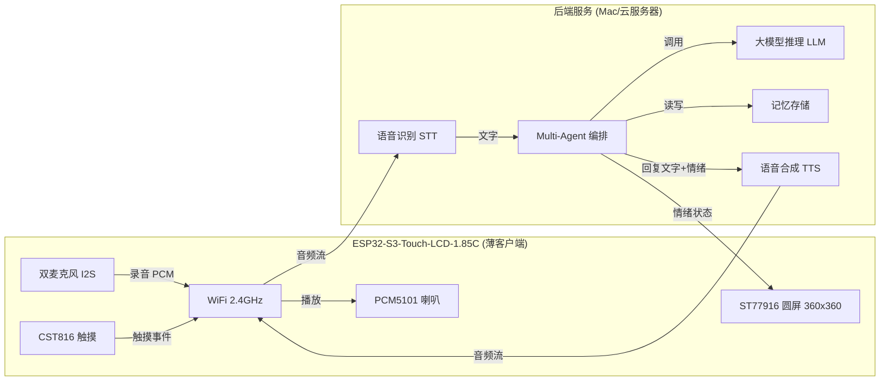
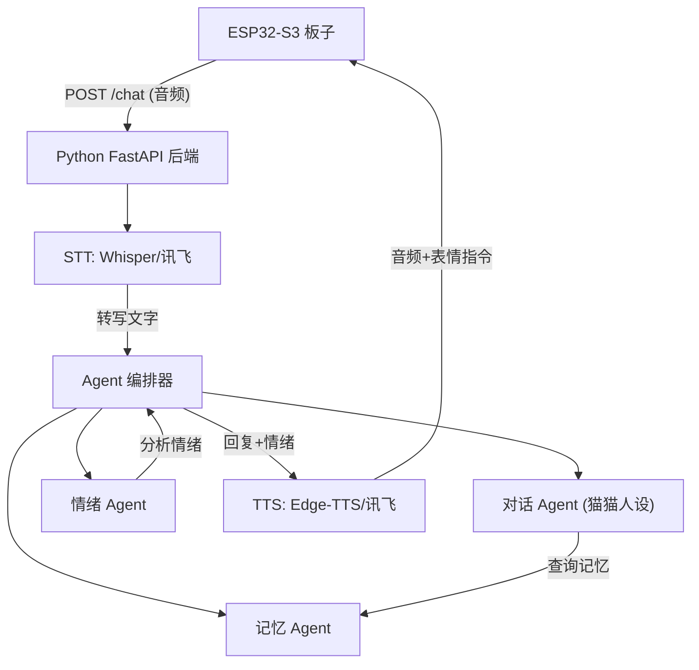

# Cyber Cat - AI 陪伴猫

基于微雪 ESP32-S3-Touch-LCD-1.85C 一体板 + 云端 AI，打造一只有表情、能听说、有记忆的 AI 陪伴猫。

ESP32-S3 作为薄客户端负责音频采集/播放和表情显示，所有 AI 推理通过云端完成。

## 硬件：微雪 ESP32-S3-Touch-LCD-1.85C 一体板

不需要任何接线！以下所有外设全部板载集成：

| 模块 | 芯片/型号 | 接口 & 引脚 |
|------|-----------|-------------|
| 主控 | ESP32-S3R8 | 双核 240MHz, 512KB SRAM, 8MB PSRAM, 16MB Flash |
| 屏幕 | ST77916, 1.85寸圆形 360x360, 262K色 | QSPI: SDA0=GPIO46, SDA1=GPIO45, SDA2=GPIO42, SDA3=GPIO41, SCK=GPIO40, CS=GPIO21, TE=GPIO18, RST=EXIO2, BL=GPIO5 |
| 触摸 | CST816 | I2C: SDA=GPIO11, SCL=GPIO10, INT=GPIO4, RST=EXIO1 |
| 喇叭 | PCM5101 音频 DAC | I2S: DIN=GPIO47, LRCK=GPIO38, BCK=GPIO48 |
| 双麦克风 | I2S 数字麦克风 (带回声消除) | I2S: WS=GPIO2, SCK=GPIO15, SD=GPIO39 |
| GPIO 扩展器 | TCA9554PWR | I2C: 控制 LCD_RST, TP_RST, SD_CS 等 |
| 陀螺仪/加速度计 | QMI8658 | I2C: SCL=GPIO10, SDA=GPIO11, INT1=EXIO5, INT2=EXIO4 |
| RTC 时钟 | PCF85063 | I2C: SCL=GPIO10, SDA=GPIO11, INT=GPIO9 |
| SD 卡 | Micro SD 卡槽 | SD: MISO=GPIO16, MOSI=GPIO17, SCK=GPIO14, CS=EXIO3 |
| 电池管理 | 支持 3.7V 锂电池充放电 | MX1.25 2PIN 接口 |
| 其他 | 音量调节旋钮, USB Type-C, RESET/BOOT 按键 | - |

**官方参考代码**：[waveshareteam/ESP32-S3-Touch-LCD-1.85C](https://github.com/waveshareteam/ESP32-S3-Touch-LCD-1.85C)

## 整体架构



## 云端 API 方案

| 能力 | 首选方案 | 备选方案 | 说明 |
|------|----------|----------|------|
| LLM（大脑） | DeepSeek API | 通义千问 / GPT-4o | 中文能力顶级，极其便宜，国内直连 |
| STT（语音转文字） | OpenAI Whisper API | 讯飞 STT | Whisper 中文识别优秀；讯飞国内更快 |
| TTS（文字转语音） | Edge TTS（免费） | 讯飞 TTS | 中文语音自然度好 |

## 开发路线

### Phase 1: 硬件基础 - "让猫睁开眼睛" (已完成 2025-04-04)

**目标**：验证所有硬件能正常工作，跑通微雪官方驱动

- [x] 修改 `platformio.ini`：配置 ESP32-S3R8 参数（PSRAM、Flash、分区表等）
- [x] 连接 WiFi 并在串口打印 IP 地址
- [x] 移植微雪官方 ST77916 + TCA9554PWR 驱动，点亮圆屏
- [x] 集成 LVGL 图形库，在圆屏上显示内容
- [x] 测试 I2S 双麦克风录音（串口打印音量值）
- [x] 测试 PCM5101 I2S 播放（播放一段内置音频）
- [x] 测试 CST816 触摸事件

**完成总结**：

使用 pioarduino 平台（Arduino ESP32 v3.1.3 + ESP-IDF 5.3），从微雪 GitHub 仓库移植全套驱动到 `lib/waveshare/`，集成 LVGL v9.3 图形库。`src/main.cpp` 按顺序初始化 I2C、屏幕、LVGL、WiFi、I2S 音频，创建测试 UI 显示 WiFi 状态、触摸坐标和麦克风音量，启动时播放 beep 提示音。所有板载硬件验证通过。

| 模块 | 验证结果 |
|------|----------|
| I2C + TCA9554PWR | OK |
| ST77916 圆屏 (QSPI 80MHz) | OK |
| CST816 触摸 (ChipID: 0xB5) | OK |
| LVGL v9.3 UI | OK |
| WiFi 2.4GHz | OK (需打开 iPhone 热点"最大兼容性") |
| I2S 双麦克风 (16kHz/16bit) | OK |
| PCM5101 喇叭 (I2S) | OK |

**踩坑记录**：
- PlatformIO 默认 `espressif32` 平台用的是 ESP-IDF 4.4，微雪驱动需要 ESP-IDF 5.x，需切换到 pioarduino 平台
- 从 GitHub 通过 WebFetch 下载的 `.h/.c` 文件中，尖括号 `<>` 的 include 会被 markdown 解析吞掉，需手动修复（如 `lv_conf.h` 中的 `<stdint.h>` 等）
- iPhone 热点默认用 5GHz，ESP32 只支持 2.4GHz，需打开"最大兼容性"

**关键驱动文件**（位于 `lib/waveshare/`，从微雪官方示例移植）：

| 文件 | 用途 |
|------|------|
| `Display_ST77916.h/.cpp` | ST77916 QSPI 屏幕驱动 |
| `esp_lcd_st77916.h/.c` | ESP-IDF LCD 底层驱动 |
| `TCA9554PWR.h/.cpp` | GPIO 扩展器驱动 |
| `Touch_CST816.h/.cpp` | 触摸屏驱动 |
| `I2C_Driver.h/.cpp` | I2C 通信封装 |
| `LVGL_Driver.h/.cpp` | LVGL 对接层 |

### Phase 2: 猫脸表情系统 - "让猫有表情" (已完成 2025-04-04)

**目标**：在 360x360 圆屏上用 LVGL 显示可切换的猫脸表情

- [x] 极简风格：纯黑背景 + 两只白色大圆眼睛，纯靠眼睛形状变化传达情绪
- [x] 实现 7 种表情：Neutral/Happy/Sad/Angry/Sleepy/Curious/Talking
- [x] 动画系统：自动眨眼（4~10s随机间隔）、说话嘴巴开合、待机眼睛随机看看
- [x] 触摸交互：点击→开心2秒、左右滑动→循环切换表情
- [ ] 利用 QMI8658 陀螺仪：摇晃板子触发晕眩表情（留到 Phase 6）

**完成总结**：

采用极简机器人/数码宠物风格——深色背景上只有两只白色大圆眼睛，所有表情完全通过眼睛的尺寸、形状、位置和旋转来表达。每只眼睛是一个 `lv_obj`，通过 `EyeState{cx, cy, w, h, rot}` 参数化控制。CST816 硬件手势检测驱动触摸交互（点击/滑动）。说话表情额外显示一个白色小嘴。

| 表情 | 眼睛效果 |
|------|----------|
| Neutral | 两个大白圆 ○ ○ (110px) |
| Happy | 扁线眯眯眼 ━ ━ |
| Sad | 缩小下移 · · |
| Angry | 扁窄+旋转 / \\ |
| Sleepy | 极细线 — — |
| Curious | 一大一小不对称 ○ ◯ |
| Talking | 圆眼 + 白色小嘴交替开合 |

**眼睛布局**（360×360 圆屏）：

- 眼睛直径 110px，左眼中心 (113, 155)，右眼中心 (247, 155)
- 间距 24px，整体偏上以配合圆屏弧度

**关键文件**：

| 文件 | 用途 |
|------|------|
| `src/cat_face.h` | CatExpression 枚举 + CatFace 类声明 |
| `src/cat_face.cpp` | 极简猫脸绘制、7种表情、动画、手势交互 |

**资源占用**：RAM 34.2%, Flash 18.6%

**踩坑记录**：
- **LVGL 触摸回调清除手势数据**：微雪的 `LVGL_Driver.cpp` 中 `my_touchpad_read` 每次读完触摸数据后会把 `touch_data.gesture` 清零为 `NONE`，导致主循环里永远读不到手势。修复：去掉 gesture 清零；同时让 `Touch_Read_Data()` 始终更新 gesture（包括 0x00=NONE），使手势结束后自然回到 NONE
- **CST816 手势方向不精确**：圆形触摸屏上滑动方向容易偏，只处理左右滑动会导致某些表情"卡住回不去"。修复：上下左右四个方向都绑定切换（右/下→下一个，左/上→上一个）
- **I2S 麦克风时钟串扰导致喇叭蜂鸣**：`mic_i2s_init()` 后 I2S 外设通过 DMA 持续在 SCK/WS 引脚产生高频时钟信号，在紧凑 PCB 上通过电磁耦合串扰到 PCM5101 DAC 音频输出通路，喇叭放大为可听见的蜂鸣声。仅拉低喇叭引脚无效（干扰源是麦克风时钟）。修复：Phase 2 不需要音频时，不初始化任何 I2S 驱动，并将全部 6 个音频 I2S 引脚（DIN/LRCK/BCK/WS/SCK/SD）主动拉低
  - **Phase 4 应对方案**：I2S 必须"按需启停"，不可常驻运行。录音时才 `i2s_channel_enable()`，录完立即 `i2s_channel_disable()` + 拉低引脚；播放同理。录音和播放不要同时进行（语音交互本身就是先听后说的流程）。如仍有残余噪声，可利用 PCM5101 的 XSMT 引脚做硬件静音

### Phase 3: 云端通信 - "让猫联网"

**目标**：ESP32-S3 能通过 HTTP/WebSocket 与后端通信

- [ ] 封装 HTTP 客户端（支持 JSON 和音频二进制上传/下载）
- [ ] 实现 WiFi 自动重连机制
- [ ] 测试调用 LLM API（发送文字，收到回复，显示在屏幕上）
- [ ] WiFi 凭证和 API Key 存入 NVS
- [ ] 可选：用 SD 卡缓存大音频文件

### Phase 4: 语音管道 - "让猫能听能说"

**目标**：实现完整的 语音输入 -> AI 回复 -> 语音输出 链路

- [ ] 双麦克风 I2S 录音 -> WAV/PCM 编码 -> 上传到后端 STT
- [ ] 后端返回 TTS 音频 -> I2S PCM5101 播放
- [ ] 实现 VAD（语音活动检测）：自动检测说话开始/结束
- [ ] 触摸屏作为"按住说话"备选方案
- [ ] 音量旋钮控制播放音量

### Phase 5: Multi-Agent 后端 - "给猫装上大脑"

**目标**：在 Mac 上搭建 Python 后端，管理多 Agent 和记忆



- [ ] **对话 Agent**：带猫猫人设的 LLM 对话（"我是一只傲娇的猫，喵~"）
- [ ] **情绪 Agent**：分析对话内容，返回情绪状态（happy/sad/angry/sleepy/curious）
- [ ] **记忆 Agent**：提取关键信息（用户名字、偏好、重要事件），长期存储
- [ ] SQLite 做记忆数据库
- [ ] 暴露 REST API：`POST /chat` 接收音频，返回 JSON（含音频 URL + 情绪）

### Phase 6: 集成与打磨 - "让猫活起来"

- [ ] ESP32 端主循环状态机（待机 -> 听 -> 思考 -> 说 -> 待机）
- [ ] 表情与语音同步（说话时嘴巴动画，开心时眼睛弯成月牙）
- [ ] 待机时随机行为（眨眼、打哈欠、摇尾巴、看来看去）
- [ ] 开机动画（猫从睡梦中醒来）
- [ ] 优化延迟（录音结束到开始回复的时间）
- [ ] 错误处理：WiFi 断连恢复、API 超时重试
- [ ] 低电量提示表情

## 最终代码结构

```
cyber_cat/
  platformio.ini
  README.md
  src/
    main.cpp                -- 主循环状态机
    config.h                -- WiFi/API 配置
    cat_face.h/.cpp         -- LVGL 猫脸表情引擎
    expressions.h           -- 表情定义
    audio_recorder.h/.cpp   -- I2S 双麦录音 + VAD
    audio_player.h/.cpp     -- PCM5101 音频播放
    voice_pipeline.h/.cpp   -- 语音管道编排
    cloud_client.h/.cpp     -- 云端 HTTP 通信
    wifi_manager.h/.cpp     -- WiFi 连接管理
  lib/
    Display_ST77916/        -- 微雪屏幕驱动（从官方示例移植）
    TCA9554PWR/             -- GPIO 扩展器驱动
    Touch_CST816/           -- 触摸屏驱动
    I2C_Driver/             -- I2C 封装
    LVGL_Driver/            -- LVGL 对接层

  backend/                  -- Python 后端（Mac 上运行）
    main.py                 -- FastAPI 入口
    agents/                 -- 对话/情绪/记忆 Agent
    memory/                 -- SQLite 记忆存储
    requirements.txt        -- Python 依赖
```

## 开发顺序

严格按 **Phase 1 -> 2 -> 3 -> 4 -> 5 -> 6** 顺序推进，每个阶段都能独立验证。
