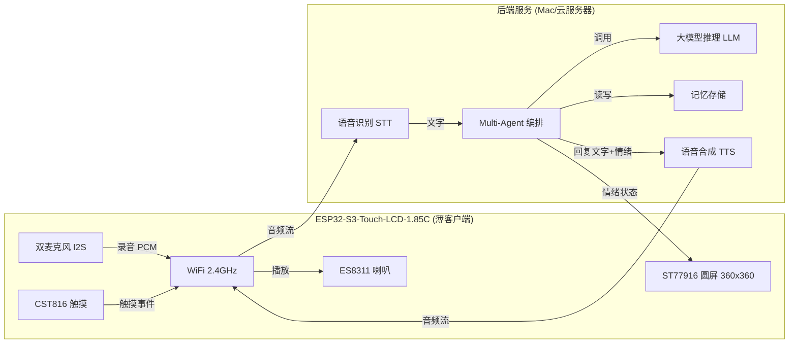

# 系统架构

[← 返回 README](../README.md)

## 整体架构



## 云端 API 方案

| 能力 | 首选方案 | 备选方案 | 说明 |
|------|----------|----------|------|
| LLM（大脑） | 通义千问 qwen-turbo | DeepSeek / GPT-4o | OpenAI 兼容接口，国内直连，速度快 |
| STT（语音转文字） | SiliconFlow SenseVoiceSmall | 讯飞 STT | Whisper 兼容接口，中文识别优秀 |
| TTS（文字转语音） | SiliconFlow CosyVoice2-0.5B | 讯飞 TTS | OpenAI 兼容接口，WAV 输出，与 STT 同一 API Key |

## 代码结构

```
cyber_cat/
  platformio.ini
  README.md
  src/
    main.cpp                -- 主循环：init + 对话状态机 + 手势/云端/VAD 轮询
    secrets.h               -- WiFi/API 凭证 (gitignored)
    secrets.h.example       -- 凭证模板
    cat_face.h/.cpp         -- LVGL 猫脸表情引擎（6种表情 + Talking 律动）
    audio_input.h/.cpp      -- I2S 麦克风录音 + VAD（遗留 I2S 驱动，全双工 RX+TX）
    es7210_mic.h/.cpp       -- ES7210 音频 ADC I2C 初始化（V2 板麦克风编解码器）
    es8311_spk.h/.cpp       -- ES8311 音频 DAC I2C 初始化 + WAV 播放（mono→stereo，PA 控制）+ 音量控制 + beep 自检
    cloud_client.h/.cpp     -- 云端通信：Phase 5 统一后端 / Phase 4 直连（STT+LLM+TTS），`#ifdef BACKEND_URL` 切换
    chat_ticker.h/.cpp      -- 屏幕底部 CJK 对话条幅（[你]/[猫]，含 emoji 过滤）
    lv_font_chinese_16.c    -- 自定义 CJK 字体（GB2312 一级 3766 字 + ASCII + 标点，4bpp 16px，lv_font_conv 生成）
    wifi_manager.h/.cpp     -- WiFi 连接管理
    lv_conf.h               -- LVGL 配置（heap→PSRAM, 60fps, CJK 字体等）
  lib/
    waveshare/
      Display_ST77916.h/.cpp  -- ST77916 QSPI 屏幕驱动
      esp_lcd_st77916.h/.c    -- ESP-IDF LCD 底层驱动
      TCA9554PWR.h/.cpp       -- GPIO 扩展器驱动
      Touch_CST816.h/.cpp     -- 触摸屏驱动（含 volatile ISR fix）
      I2C_Driver.h/.cpp       -- I2C 通信封装
      LVGL_Driver.h/.cpp      -- LVGL 对接层（含 skip mode 渲染暂停 + update callback + 心跳计数器 + 超时 guard）

cyber_cat_backend/            -- Python 后端（Phase 5，部署到腾讯云 122.51.129.89:8000）
  main.py                     -- FastAPI 入口（/chat + /health + TTS 缓存清理）
  services/
    stt.py                    -- SiliconFlow SenseVoice 语音转文字
    llm.py                    -- DashScope LLM 对话生成 + 记忆提取
    tts.py                    -- SiliconFlow CosyVoice2 文字转语音
    emotion.py                -- 情绪分析（规则匹配）
  memory/
    database.py               -- SQLite 数据库初始化
    repository.py             -- 短期/长期记忆读写（sessions + long_term_memory）
  requirements.txt            -- Python 依赖
  cybercat-backend.service    -- systemd 守护进程配置
  .env.example                -- 环境变量模板（API Key 等）
```
