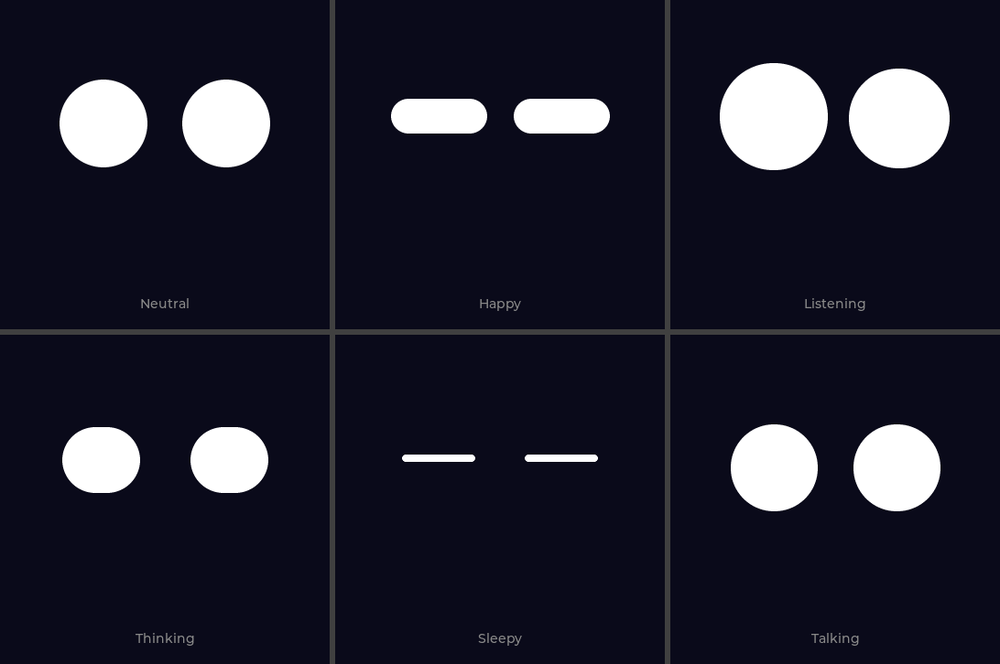

# 表情与动画改造方案

[← 返回 README](../README.md) · [开发路线](roadmap.md)

> 状态：v2（阶段 0–4 与 3.5）于 2026-10-20 实施，v3（Cozmo 赛博几何扫描线引擎 + 83fps 高帧率管线）于 2026-10-21 完成并合入真机。详见 5.2 与 5.3 节。
> 范围：`src/cat_face.*`、`src/main.cpp` 中与表情/状态相关的部分、`lib/waveshare/LVGL_Driver.cpp` 与 `Display_ST77916.cpp` 的渲染链路。

## 1. 目标

1. **丝滑**：所有状态下（包括 THINKING / TALKING）稳定 ~60fps，任何时刻切换表情都不跳变。
2. **生动**：表情有辨识度，动作有节奏变化（预备、过冲、回弹、左右眼微差），不再像"统一 350ms 插值"。
3. **逻辑清晰**：情绪（mood）和对话状态（activity）解耦，每个状态下的表情和触摸行为都有明确定义。

## 2. 现状梳理

```
main.cpp (Core 1)                     LVGL task (Core 0, 每 16ms)
  对话状态机 IDLE/LISTENING/            lvglUpdateCb()
  THINKING/TALKING                        ├─ catFace.setExpression(pending)
  requestExpr(e) ──volatile flag──▶       ├─ catFace.update()  ← 手势解析 + tap→Happy
                                          └─ lv_timer_handler() ← 被 flush_skip 跳过
CatFace
  _apply(e): 删除全部动画 → from=_base, to=预设 → 350ms ease_in_out 插值
  独立 lv_anim：blink / look / breath / drowsy / talk，每个回调各自调用 _render()
  _render(): lerp + 呼吸 ±2px + 眨眼压高度 + 看向偏移 → _placeEye() 设置 size/radius/pos/rotation
```

每只眼睛就是一个圆角矩形 `lv_obj`。旋转因为"LVGL transform broken"已全部置 0（见 `cat_face.cpp` 的 `TALK_STAGES` 和 `CAT_THINKING` 注释）。所以表情只能靠宽、高、位置三个量来表达。

## 3. 问题清单

标记说明：🔴 高（用户直接可见的 bug） 🟠 中（明显影响观感） 🟡 低（优化项）。"需实测"表示只从代码推断出来，还没在设备上确认过。

### 3.1 表情逻辑

| # | 级别 | 问题 | 位置 |
|---|------|------|------|
| L1 | 🔴 | **THINKING 表情从来不显示**。`enterThinking()` 先 `requestExpr(CAT_THINKING)`，紧接着加锁设置 `flush_skip=true`。LVGL task 下一轮会在 `lvglUpdateCb` 里执行 `setExpression`，但随后 `lv_timer_handler()` 被跳过，动画一帧都没渲染。结果整个思考期间屏幕**冻结在 Listening 的最后一帧**，等到 TALKING 时再从 Listening 直接变过去 | `main.cpp` `enterThinking()`；`LVGL_Driver.cpp` `LVGL_Loop()` |
| L2 | 🟠 | **情绪覆盖了说话动画**。`emotionToExpr()` 把后端返回的 `happy/neutral/thinking` 直接映射为表情，再交给 `enterTalking(reply, expr)`。只有 emotion 未知时才会走 `CAT_TALKING` 律动。后端大多返回这三个值，所以猫说话时眼睛通常不动；emotion=`thinking` 时，说话期间看起来还在"思考" | `main.cpp` `emotionToExpr()` / `enterTalking()` |
| L3 | 🔴 | **切换表情时会跳变**。`_apply()` 以 `_baseL/_baseR`（纯插值结果）为起点，忽略了当前叠加在上面的眨眼、看向、呼吸、困倦、说话律动，并把这些偏移瞬间清零。最明显的一处：90s 困倦已把眼睛压到 20px，120s 进入 Sleepy 时眼睛会先**弹回 95px** 再缩成 8px。眨眼中途、看向中途、说话律动中途切表情也会跳 | `cat_face.cpp` `_apply()`、`startDrowsy()` |
| L4 | 🟠 | **说话时无法打断**。`touch_skip` 从 THINKING 开始置位，一直到回到 IDLE 后 2s 才恢复，所以 TALKING 期间触摸完全无效，`onLongPress()` 里对 TALKING 的分支实际是死代码。另外 IDLE 后 2s 内的触摸也会被吞掉 | `main.cpp` `enterThinking()` / `enterIdle()` |
| L5 | 🟠 | **出错时没有反馈**。没有 WiFi、STT 失败、超时，都只是安静地回到 Neutral，用户分不清是"没听见"还是"出错了" | `main.cpp` `CLOUD_ERROR` 分支、THINKING 超时 |
| L6 | 🟡 | **唤醒生硬**。从 Sleepy 点击只做一次 350ms 变形回 Neutral。长按时更糟：先 `_apply(NEUTRAL)` 紧接着进入 LISTENING，两次变形互相打断 | `cat_face.cpp` `update()` |
| L7 | 🟡 | **空闲计时只算触摸**。`lastInteractMs` 只在手势时更新，对话结束不会重置。一段 30s 的对话结束后，再过约 60s 就开始犯困 | `cat_face.cpp` `update()`；`main.cpp` `lvglUpdateCb()` |
| L8 | 🟡 | **长按没有即时反馈**。CST816 硬件手势要按住约 1s 才上报 LONG_PRESS，期间屏幕毫无反应，用户会以为没按到 | `cat_face.cpp` `update()` |
| L9 | 🟡 | **职责混杂**。`CatExpression` 把"情绪"（Happy/Neutral）和"状态"（Listening/Thinking/Talking/Sleepy）混在一个枚举里；tap→Happy 的业务逻辑写在 `CatFace` 里，对话逻辑在 `main.cpp`，两边都在解释手势 | `cat_face.h`、`main.cpp` |

### 3.2 动画设计（"生硬"的来源）

| # | 级别 | 问题 |
|---|------|------|
| A1 | 🟠 | 所有表情切换都是同一条 350ms `ease_in_out`，两只眼完全同步，宽、高、位置同时开始、同时结束，看上去很机械 |
| A2 | 🟠 | 看向固定是"250ms 移过去 → 停 1s → 250ms 回中心"。真实眼动是快速跳视（约 50–80ms）后停留在新位置，不会每次都回中心。而且幅度只有 ±8px，相对 95px 的眼睛几乎看不出来 |
| A3 | 🟠 | 呼吸是宽高同时 ±2px、周期 3.5s。像素是整数，实际表现为每隔约 0.4s 跳 1px，再加上 `w/2` 取整导致中心左右摆动，看起来是**抽动**而不是呼吸 |
| A4 | 🟡 | 眨眼是高度向中心压扁（上下同时合拢），节奏固定，没有双眨眼，左右眼也没有时间差 |
| A5 | 🟠 | Talking 律动是固定 450ms 的循环，跟实际语音无关，更像抽搐；停止时还会瞬间复位 |
| A6 | 🟡 | Listening 每 0.6–0.9s 把眼睛缩到 70px 再弹回，看起来像抽动，也不随用户声音变化 |
| A7 | 🟠 | 旋转被禁用后只剩"胶囊形"：Happy 就是一个扁胶囊（105×38），做不出 ^ ^ 的笑眼；Thinking（85×72）和 Neutral（95×95）几乎分不出来 |
| A8 | 🟡 | 文档与代码不一致：Phase 2 文档写 Thinking ±5°、Talking ±10° 旋转，代码里全是 0 |

### 3.3 渲染链路（"不丝滑"的来源）

| # | 级别 | 问题 |
|---|------|------|
| R1 | 🔴 | `flush_skip` 机制：THINKING 期间整个 UI 冻结（即 L1）。它当初是为绕开 WDT 和渲染死循环加的补丁，现在 WDT 已经重新配置，worker 也已绑到 Core 1，具备删除条件（Phase 6 待办里已有此项） |
| R2 | 🟠 | 每帧最多有 5 个 lv_anim 回调，每个都调一次 `_render()`。每次都对两只眼重新 `set_size` / `set_style_radius` / `set_pos` / `set_style_transform_rotation`，其中设置本地样式会触发样式刷新，属于重复失效和重复计算 |
| R3 | ⚪ 不成立（见 5.2） | `LCD_addWindow()` 用 CPU 对 PSRAM 中每个像素做字节交换。`esp_lcd_panel_draw_bitmap()` 是异步排队的，但 `my_disp_flush()` 在 DMA 发完前就调用了 `lv_display_flush_ready()`，存在 LVGL 改写正在发送的缓冲区的风险 |
| R4 | 🟡 需实测 | TE（GPIO18）被设成 OUTPUT，没有做防撕裂同步。快速眨眼时可能出现横向撕裂 |
| R5 | 🟠 已实测 | `LVGL_Loop` 每次干完活后再固定 `vTaskDelay(16)`，循环周期 = 16ms + 渲染耗时。实测有动画时约 22.7ms/次，**帧率被卡在约 42fps**，达不到 60（见 5.1） |

## 4. 改造方案

### 4.1 设计原则

- **每帧只算一次、只写一次**：一个 16ms 的 face tick 计算出完整姿态，然后只在值变化时更新对象或重绘。
- **用弹簧代替定长插值**：每个参数都朝目标值做阻尼弹簧运动。这样随时可以改目标，天然连续，不会跳变，还自带轻微过冲。
- **分层合成**：基础姿态（情绪 × 状态）+ 视线 + 眨眼 + 呼吸 + 语音，每层只负责自己那部分。
- **情绪和状态解耦**：情绪决定"眼睛长什么样"，状态决定"眼睛在做什么"。
- **先在模拟器里调参**：`lvgl_sim` 直接编译 `cat_face.cpp`，调表情不用每次烧录。

### 4.2 渲染链路（先做，否则后面的调参都没有意义）

1. **删除 `flush_skip` / `touch_skip`**，让 LVGL 在所有状态下正常渲染。删除后要做压力测试：连续 50 次对话，检查 `[Health]` 里的 lvgl 计数持续增长、没有 `WARN: stuck`、堆内存稳定。
2. **改成真正的异步刷屏**：在 `on_color_trans_done` 回调里调用 `lv_display_flush_ready()`，同时把显示格式设为 `LV_COLOR_FORMAT_RGB565_SWAPPED`（LVGL 9.2+ 支持；若 9.3 下不可用，改为在渲染后调用 `lv_draw_sw_rgb565_swap()`），去掉 CPU 逐像素交换。
3. **稳定帧节奏**：`LVGL_Loop` 改用 `vTaskDelayUntil`，或者按 `lv_timer_handler()` 的返回值决定延时。
4. **TE 防撕裂**（可选，按实测决定）：把 TE 改成输入，刷屏前等待 TE 信号。
5. **可观测性**：在 `[Health]` 里增加 `fps=` 和 `render_ms_max=`，改造前先记一份基线。

### 4.3 动画引擎：参数化的脸 + 弹簧

每只眼睛用一组参数描述，全部是 float（ESP32-S3 有单精度 FPU）：

```cpp
struct EyePose {
    float x, y;          // 中心偏移（相对默认位置）
    float w, h;          // 眼白尺寸
    float lidTop;        // 上眼睑遮挡 0..1（眨眼、困、眯眼）
    float lidTopTilt;    // 上眼睑倾斜 -1..1（内低 = 生气/专注，外低 = 难过/困）
    float lidBottom;     // 下眼睑上推 0..1（笑眼 ^ ^）
};

struct Spring {
    float x = 0, v = 0, target = 0;
    float freq = 4.0f;   // Hz，越大越快
    float damp = 0.8f;   // <1 有过冲，=1 临界阻尼
    void step(float dt) {
        float w = 2 * PI * freq;
        v += (w * w * (target - x) - 2 * damp * w * v) * dt;
        x += v * dt;
    }
};
```

每帧的合成顺序：

```
基础姿态 = 弹簧追踪 preset[mood][activity]，左右眼的 freq 相差 ±5–10%，产生自然的先后
  + 视线：跳视。目标值离散跳变，用高频弹簧（freq≈8, damp≈0.9），停留 0.8–4s 随机，不强制回中心
  + 眨眼：脚本曲线控制 lidTop（闭 70ms / 开 120ms），15% 概率双眨，左右眼错开 0–20ms
  + 呼吸：正弦作用在 lidTop（0→0.05）和 y（±1px），只动一条边，避免宽高同时 ±1px 的抖动
  + 语音：TTS 播放包络 → h 压缩 + y 上提（见 4.6）
  + 微动：低幅噪声，避免完全静止
→ 取整 → 只在像素值变化时重绘
```

要点：
- **连续性**：切换表情只是修改弹簧的 `target`，`x` 和 `v` 原样保留，从根本上消除 L3 的所有跳变。
- **不同参数用不同节奏**：比如 Happy 时 `lidBottom` 快（freq 6），`y` 慢（freq 3），自然形成"先笑眼，再上扬"的层次。
- 预设里可以带"预备动作"：例如进入 Listening 前先微缩 80ms 再放大（anticipation）。
- `dt` 限制在 ≤ 50ms，防止卡顿后弹簧发散。
- 对外暂时保留 `setExpression()` API，`main.cpp` 在阶段 2 无需改动。

### 4.4 眼睛造型：眼睑遮罩

不依赖旋转。在一个自定义对象的 `LV_EVENT_DRAW_MAIN` 里，用 LVGL 软件渲染直接画：

1. 白色圆角矩形（眼白）。
2. **上眼睑**：用背景色的三角形加矩形覆盖。三角形的两个顶点高度不同，就是倾斜（`lv_draw_triangle`，不需要矩阵变换）。
3. **下眼睑**：用背景色的大圆从下往上推，与眼白相减后得到月牙形笑眼 ^。

这样能画出的表情：

| 表情 | 造型 |
|------|------|
| Neutral | 圆眼，`lidTop≈0.05` |
| Happy | `lidBottom≈0.55`，月牙笑眼，整体 y 上提 |
| Listening / Curious | 放大 10–15%，单侧 `lidTop` 略低，视线锁定 |
| Thinking | 视线上移到侧上方并缓慢漂移，`lidTop≈0.3`，内侧微低 |
| Sleepy | `lidTop≈0.85`，缓慢呼吸，偶尔半睁 |
| Surprised（新） | 放大 20%，`lidTop=0`，配一次快速过冲 |
| Confused（新） | 左右眼大小不对称，单侧倾斜，用于出错反馈 |

只让眼睛包围盒对应的区域失效（每只约 130×130），刷屏数据量和现在相当。

### 4.5 表情逻辑：Mood × Activity

```
Activity（由 main.cpp 的对话状态机驱动）
  IDLE / LISTENING / THINKING / TALKING / SLEEPING

Mood（由后端 emotion 和交互驱动，有衰减）
  NEUTRAL / HAPPY / CURIOUS / CONFUSED / SURPRISED
```

最终姿态由 `preset(mood, activity)` 决定，同时开启对应的行为层。

| Activity | 姿态与行为 | 触摸 |
|----------|-----------|------|
| IDLE | mood 姿态 + 随机跳视 + 眨眼 + 呼吸 | 按下即时微反应；点击 → mood=HAPPY 2s；长按 → LISTENING |
| LISTENING | 放大、视线锁定，眼睛随**麦克风 RMS** 轻微放大或收紧 | 点击 → 结束录音；长按 → 取消 |
| THINKING | 视线上移并漂移，`lidTop` 半垂，可加"省略号"式慢速左右扫视 | 点击忽略；长按 → 取消本次请求 → IDLE（见 4.8） |
| TALKING | **mood 姿态 + 语音层叠加**：情绪决定眼形，语音决定律动 | 点击 → 打断播放 → IDLE；长按 → 打断并直接进入 LISTENING（见 4.8） |
| SLEEPING | 重眼睑 + 慢呼吸 | 点击 → 唤醒动画（先睁一只眼，伸懒腰式过冲）→ IDLE；长按 → 唤醒后直接 LISTENING，一次连续过渡 |

关键修正：
- emotion **只修改 mood**，不再替代 TALKING（修 L2）。
- CURIOUS / CONFUSED / SURPRISED 只由本地事件触发；后端 emotion 仍然只有 `happy` / `thinking` / `neutral` / `talking`，映射为 mood（`thinking` → CURIOUS，`talking` → NEUTRAL）。
- 新增反应事件，本质上是带时长的 mood 脉冲：`onError()` → CONFUSED 1.5s（修 L5），`onWake()` → SURPRISED 0.4s，没有 WiFi 时长按 → CONFUSED 并在屏幕顶部闪一下 WiFi 状态点。
- 空闲计时以"最后一次触摸或对话结束"中较晚者为准（修 L7）。
- 触摸按下（`points>0`）立即给反馈：眼睛轻微下压并看向手指的方向，长按达到阈值时再进入 LISTENING（修 L8）。
- 职责划分：`CatFace` 只负责"画"和"动"，对外暴露 `setActivity()` / `setMood()` / `pulseMood()` / `setSpeechLevel()` / `setListenLevel()`。手势的含义统一由 `main.cpp` 的状态机解释（修 L9）。

### 4.6 音频驱动

- **说话**：在 `es8311Play()` 的写入循环里，每 20ms 计算一次块 RMS，写进 `std::atomic<uint16_t>`。CatFace 每帧读取，经过包络跟随（起音 30ms、释放 120ms）后映射到 `h` 压缩（最多 -25%）和 `y` 上提。音节越重眼睛越扁，停顿时自然回圆。
- **聆听**：`audioInputProcess()` 已经算出 RMS（`audio_input.cpp`），同样发布出来，驱动 Listening 的眼睛轻微放大和收紧，让用户看到"它在听我说"。
- 两个电平都只跨核传递一个原子变量，不需要锁。

### 4.7 待机行为调度

用一个简单的加权随机行为表代替现在各自独立的定时器：

| 行为 | 权重 | 说明 |
|------|------|------|
| 跳视到随机点并停留 | 高 | 停留 0.8–4s，30% 概率回中心 |
| 双眨眼 | 中 | |
| 慢眨眼（Happy 时权重高） | 中 | 猫的"信任信号" |
| 好奇歪头 | 低 | 左右眼一高一低，加单侧眼睑 |
| 打哈欠前兆（60s 后权重上升） | 低 | 引出困倦过渡 |

### 4.8 打断与取消

**打断说话（TALKING 时点击 / 长按）**

- `es8311_spk` 增加 `es8311RequestStop()`，设置一个 `std::atomic<bool>`。`es8311Play()` 的写入循环每写完一块就检查一次，若被置位：停止写入 → 用 DMA 清零尾部 → PA_CTRL 拉低（沿用现有 80ms drain，防止爆音）→ 返回 `false` 并标记"已打断"。
- `cloud_client` 区分"被打断"和"播放失败"：被打断时上报 `CLOUD_TTS_DONE`，不走错误分支，避免触发 CONFUSED。
- 表情：点击打断时 mood 脉冲一次 SURPRISED（0.3s）后回到 IDLE；长按则直接进入 LISTENING，不经过 IDLE 的表情，保证过渡连续。

**取消请求（THINKING 时长按）**

- HTTP 请求在 Core 1 的 worker 里阻塞执行，无法安全地中途终止。做法是**放弃结果**，而不是真的中止：`CloudClient` 维护一个请求代号 `requestId`，取消时代号加 1，worker 完成后发现代号已变，就丢弃结果并直接回到空闲。
- 取消后猫立即回到 IDLE。worker 仍在跑的这段时间（最多 HTTP 超时 15–30s），如果用户再次长按：允许录音，但上传要排队，等旧 worker 结束后再发。录音时长本身通常够长，用户基本感觉不到。
- 被丢弃的请求不会写入设备端状态，但**后端已经把这一轮对话记进记忆**。这一点暂时接受，后续如有需要可在后端加取消接口。

### 4.9 装饰元素（瞳孔 / 腮红 / 小嘴）：可选实验层

你希望加这些元素，之前的尝试效果不好。本方案把它们做成**可开关的独立图层**，阶段 3 的眼睛造型定稿之后再单独实验，效果不好就整体关掉，不影响主线。

极简脸加元素后"不好看"，常见原因有这几个，设计时逐条规避：

| 常见原因 | 规避方式 |
|----------|----------|
| 元素是静止贴上去的，和眼睛的动作不联动，像贴纸 | 所有元素都由同一套 `EyePose` 驱动：瞳孔跟随视线（幅度是眼白位移的 1.5–2 倍，产生视差）；笑眼时腮红变亮、上移；说话时小嘴跟语音包络开合 |
| 元素太多、太满，失去极简感 | 一次只加一种，按"瞳孔 → 腮红 → 小嘴"的顺序逐个评估；每个元素都要回答"它增加了什么情绪信息" |
| 颜色太饱和、对比太硬 | 只用低饱和色；腮红用低透明度（`LV_OPA_30` 左右）的柔和粉色，不画硬边 |
| 比例和位置不对，像人脸而不像猫 | 小嘴用很小的 "ω" 或单弧线，放在两眼中线偏下、靠近眼睛（不要放在屏幕下方）；在模拟器里做 2–3 个比例方案并排截图对比 |
| 圆屏边缘被裁切，或和字幕区重叠 | 所有元素限制在半径约 150px 的安全圆内，并避开底部字幕区（y > 260） |

评估方式：在模拟器里用键盘切换"无装饰 / 瞳孔 / 瞳孔+腮红 / 全部"，对每种表情截图拼成一张对比图，由你挑选。最终用编译开关 `FACE_DECOR` 和运行时开关同时控制。

## 5. 实施计划

| 阶段 | 内容 | 预估 | 验收标准 |
|------|------|------|----------|
| 0 基线与工具 | `[Health]` 加 fps / render_ms；修复 `lvgl_sim` 的路径（目前写死为其他机器的 `/Users/weizhong.wang/...`），拉取 `lvgl` 子模块，在本机跑起模拟器；用手机 240fps 慢动作录一份各表情的基线视频 | 0.5 天 | 模拟器能运行现有表情；有基线 fps 数据 |
| 1 渲染链路 | 4.2 的 1–3（TE 视实测再定）；单次 render | 1–2 天 | 所有状态 ≥55fps；THINKING 能看到动画；连续 50 次对话无卡死、堆稳定 |
| 2 动画引擎 | `EyePose` + `Spring` + 分层合成，先套用现有造型（暂不改眼睑），保留 `setExpression()` 接口 | 2–3 天 | 模拟器里每 100–500ms 随机切换表情、持续 10 分钟，肉眼和慢动作都看不到跳变 |
| 3 眼睛造型 | 自定义绘制 + 眼睑；在模拟器里调各表情预设 | 2 天 | 7 种表情截图互相可区分；单帧渲染 < 8ms |
| 3.5 装饰实验 | 4.9 的瞳孔 / 腮红 / 小嘴图层，模拟器出对比图 | 1–2 天 | 你从对比图里选定方案（也可以选"不加"） |
| 4 表情逻辑 | Mood × Activity、音频驱动、错误反馈、唤醒、触摸即时反馈、空闲计时、4.8 的打断与取消；同步更新 `docs/phase2-cat-face.md` | 2–3 天 | 对照 4.5 的表格逐条手测；说话律动与语音节奏一致；打断后 200ms 内静音且无爆音 |
| 5（可选）后端情绪 | 后端 emotion 扩展为 LLM 分类，加 intensity；`/chat` 返回 transcript | 1 天 | 暂缓：新情绪先只用于本地事件 |

### 5.1 阶段 0 结果（2026-10-20）

已完成：
- `[Health]` 增加 `fps` / `render_max` / `expr` 字段；新增串口命令 `expr <n>`，不用碰屏幕即可切换表情（阶段 4 后由 `act` / `mood` 取代，见[调试与测试](debugging-and-testing.md)）。
- 模拟器在本机跑通：LVGL 子模块锁定到 v9.3.0（与固件一致，消除第 8 节的版本风险），修复 CMake 的 SDL 头文件路径，新增 `--shots` 截图模式。
- 慢动作基线视频需要你用手机录（Neutral 待机、点击 Happy、一次完整对话），录好后放进 `docs/img/`。

设备实测基线（串口命令切换表情，每个 10s 窗口）：

| 表情 | fps | render_max | 说明 |
|------|-----|------------|------|
| Neutral | 42.3 | 10ms | 呼吸动画持续运行，代表"满负荷"帧率 |
| Talking | 41.6 | 10ms | 律动持续运行 |
| Happy | 9.6 | 8ms | 只有慢眨眼，大部分时间静止 |
| Thinking | 6.4 | 8ms | 偶尔看向；对话中实际为 0（被 `flush_skip` 冻结，见 L1） |
| Sleepy | 2.6 | 10ms | 基本静止 |
| 开机首帧 | — | 63ms | 全屏首次绘制 |

结论：
- **渲染本身不慢**：单次 `lv_timer_handler()` 最长约 10ms，16ms 的帧预算里还有富余。
- **帧率上限是循环节奏造成的**：有动画时 LVGL 循环约 44 次/秒，fps 被卡在约 42。修复 R5 后预计能接近 60fps，这是阶段 1 收益最直接的一项。
- 模拟器基线图：



建议分 PR 推进：阶段 1 单独一个 PR，因为它会改变系统稳定性，必须先在设备上压测；阶段 2、3 可以主要在模拟器里迭代；阶段 4 需要在设备上联调。

### 5.2 阶段 1–4 结果（2026-10-20）

阶段 1–4 和 3.5 已整体实现，现状说明见 [Phase 2 文档](phase2-cat-face.md)。


已完成：
- **渲染链路**：删除 `flush_skip` / `touch_skip`（修 L1，Thinking 时眼睛正常动）；字节交换改用 `lv_draw_sw_rgb565_swap`；LVGL 循环按 `lv_timer_handler()` 返回值休眠（修 R5）
- **引擎**：Mood × Activity、弹簧、分层合成、自绘眼睑，接口见 `cat_face.h`
- **逻辑**：第 4.5、4.8 节的手势表、打断 / 取消、取消后排队发送、错误 → Confused、醒来不对称、渐进犯困
- **装饰层**：瞳孔 / 腮红 / 小嘴，默认关闭，串口 `decor <mask>` 切换，对比图见 [decor-variants.png](img/decor-variants.png)
- **工具**：串口 `act` / `mood` / `pulse` / `decor` / `tap` / `hold` / `silent` / `chat` / `stress`；模拟器新增按键和 `--decor-shots`

设备实测：
- 静音压测 `stress 12`（含 3 次说话中打断、3 次思考中取消）：11 通过，1 次后端读超时，错误路径正确；堆内存全程在 7.48MB 左右，无泄漏，无 `stuck` 告警
- `render_max` 7–22ms（装饰全开时首帧 32ms）
- `pio test` 6/6 通过

未达标 / 未验证：
- **帧率**：眼睛持续运动时实测 30–40fps，未达到 ≥55fps 的验收线。静止时只刷变化区域，fps 本来就低，这部分正常。持续运动时的瓶颈还没定位，下一步先看 flush 是否仍阻塞，以及标脏区域是否过大
- **压测轮数**：只跑了 12 轮，验收标准是 50 轮
- **需要真人在设备前确认**：触摸手感（长按 600ms 阈值）、打断时有无爆音、说话律动与语音是否同步、慢动作视频对比

更正：
- **R3 不成立**：SPI master 在排队时会把 PSRAM 缓冲区拷贝到内部 RAM，LVGL 提前复用缓冲区不会改写正在发送的数据

额外发现（后端，SSH 到 `Tencent_cloud` 查日志确认）：设备偶发的 `read Timeout` 与会话无关。后端 `/chat` 依次串行调用 SiliconFlow 的 STT → LLM → TTS，单次耗时实测 3.5–9.6s，偶尔超过 15s（日志中有一次 STT 上游 `httpx.ReadTimeout`，30s 后返回 500）。固件 `HTTP_TIMEOUT_MS` 是 15s，长尾请求会先在设备端超时，后端随后仍返回 200。

### 5.3 v3 赛博扫描线表情引擎与 83fps 性能优化（2026-10-21）

针对 v2 在真机上"几何切割感太硬、缺乏灵动细节"以及"连续运动只有 30–40fps"两个问题，进一步完成了 v3 升级（当前运行版本，详见 [phase2-cat-face.md](phase2-cat-face.md)）：


1. **视觉与造型升级（圆润大眼 + 双圆高光 + 纯净无条纹）**：
   - 全部表情改为 **100% 纯圆 / 椭圆轮廓**（`dyCircle = hh * sqrt(1 - u^2)`），眼内配备**一大一小两颗圆高光点**（以 6.2Hz 欠阻尼弹簧做次级跟随运动）。`Curious` / `Confused` / `Thinking` 均采用一大一小双圆眼组合，彻底去掉了把眼睛切成方形的上下平直遮罩；`Sad` / `Angry` 用多项式平滑极值 `smaxf` 对眼睑交界做圆角过渡。
   - **彻底消除黑条纹**：去掉了水平扫描线隔行压暗与斜线腮红间隙，改为**纯净实心抗锯齿填充 + 柔和二次衰减椭圆粉腮红**；同时修复了片上 DMA SRAM 双缓冲下 `my_disp_flush` 提前释放缓冲区导致 QSPI DMA 传输途中被清屏黑底覆盖的水平黑条纹撕裂 bug（现由 `Display_ST77916.cpp` 的 `on_color_trans_done` DMA 完成中断通知 `lv_display_flush_ready`）。
2. **动态物理与自主生命感**：
   - 加入**体积守恒挤压拉伸**、**大角度扫视联动半眨眼 + 速度惯性斜切**、**快慢双包络音节起音拍点（Syllable Onset Beat）**弹跳，以及 5 段**待机自主微表情小剧场**（左右张望、歪头挑眉、满足眯眼、警觉竖眼、犯困钓鱼猛醒）。
3. **30fps → 83.3fps 的 5 项底层优化**：
   - **片上 DMA SRAM 双缓冲**：`disp_draw_buf1/2`（各 25.9KB）从外部慢速 PSRAM 迁入 `MALLOC_CAP_INTERNAL | MALLOC_CAP_DMA` 片上 SRAM。
   - **去掉后台 `swdraw` 渲染线程**：`lv_conf.h` 中 `LV_USE_OS` 设为 `LV_OS_NONE`，刷新周期设为 `12ms`。
   - **触摸 I2C 400kHz + 中断按需读取**：`I2C_Init` 启用 400kHz，`my_touchpad_read()` 仅在 `Touch_interrupts` 触发或手指按住时才发起 I2C 读取，平时耗时 0µs。
   - **LUT 加速单遍列扫描光栅化**：每只眼预计算 `lut565[3][16]`（3 种扫描线亮度 × 16 级覆盖度）RGB565 查找表，内部实心区域零浮点指针直写，腮红改用全整数运算。
   - **左右眼独立局部脏区**：将腮红并入左右眼各自包围盒，避免横跨全屏的无效刷新。

**v3 真机实测帧率（`[Health]` 10s 统计窗口）**：

| 状态 / 情绪 | v2 fps | v3 fps | v3 render_max |
|-------------|--------|--------|---------------|
| `Idle / Neutral` | 15–30 | **70.5 – 83.2** | 14ms |
| `Idle / Happy` | ~31 | **83.3** | 13ms |
| `Idle / Love`（含爱心+腮红+摇晃） | — | **71.2** | 18ms |
| `Idle / Sad`（含动态水波泪光） | — | **74.5** | 18ms |
| `Idle / Angry`（含高频微颤） | — | **83.3** | 12ms |
| `Idle / Wink` | — | **83.3** | 13ms |
| `Listening / Thinking` | 14–21 | **83.2** | 13–14ms |
| `Talking`（TTS 播放 + 字幕同屏） | 26–31 | **81.2** | 29ms |

## 6. 验证方法

- **模拟器**：调参和连续性测试（键盘快速切换表情、模拟语音电平）。
- **设备日志**：`[Health]` 里的 fps / render_ms / heap / lvgl 计数。
- **慢动作视频**：改造前后各录一份，对比跳变、撕裂和节奏。
- **静音集成测试**：`pio test` 保证改造不影响对话链路（见[调试与测试](debugging-and-testing.md)）。

## 7. 已确认决策（2026-10-20）

| 问题 | 决定 | 落实位置 |
|------|------|----------|
| 是否允许打断说话 | 允许 | 4.5 触摸列、4.8 |
| 是否加瞳孔 / 腮红 / 小嘴 | 想加，但之前的效果不好 → 做成可开关的实验层，眼睛定稿后再评估 | 4.9、阶段 3.5 |
| 新情绪是否需要后端支持 | 先只用于本地事件 | 4.5、阶段 5 暂缓 |
| THINKING 时长按是否取消请求 | 可以 | 4.5 触摸列、4.8 |

## 8. 风险

| 风险 | 应对 |
|------|------|
| 删除 `flush_skip` 后重新出现渲染死循环 | 当初的死循环由"skip 时 flush 瞬间完成"触发，删除 skip 后这个触发条件就不存在了。保留 `lv_timer_handler` 超时 guard，并做阶段 1 的压测 |
| TLS 上传期间 Core 0 被 WiFi 中断占用，帧率下降 | 先实测；必要时在 THINKING 期间把动画降到 30fps，而不是冻结 |
| 自定义绘制性能不足 | 每只眼睛只用几个图元，区域小；阶段 3 先在设备上测单帧耗时再铺开 |
| 模拟器（LVGL 9.5）与固件（LVGL 9.3）行为不一致 | 改造前统一版本，或把模拟器的 LVGL 锁定到 v9.3 |
