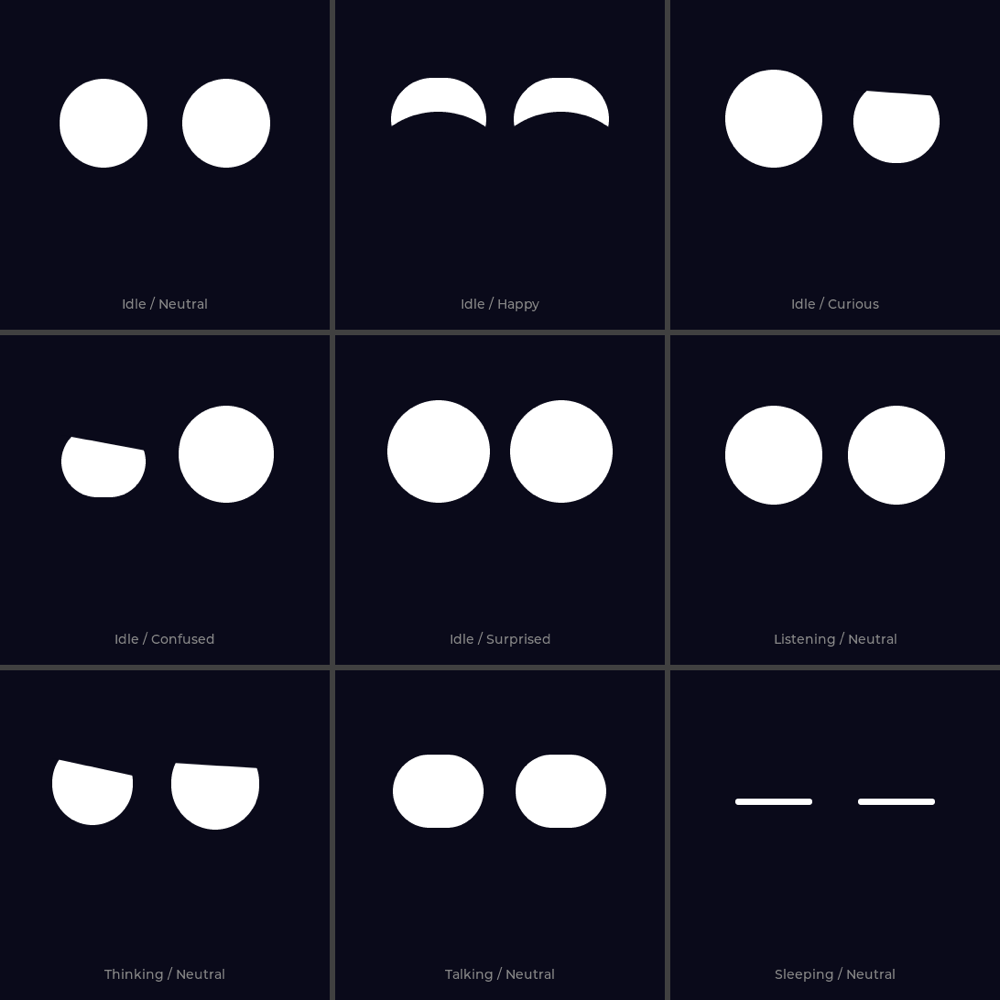
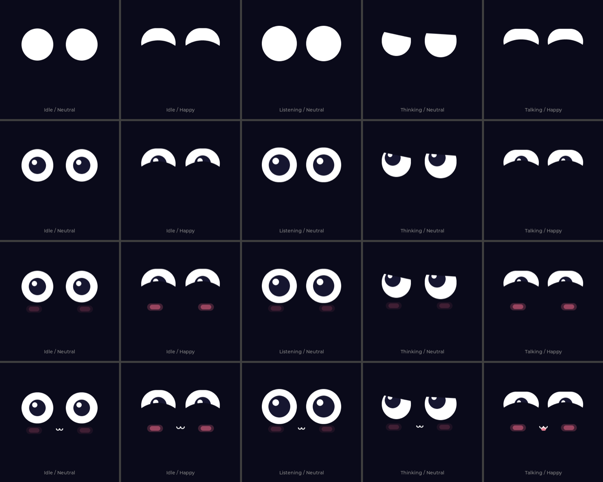

[← 返回 README](../README.md) · [开发路线](roadmap.md) · [改造方案](face-animation-redesign.md)

# Phase 2: 猫脸表情系统 - "让猫有表情"

Phase 2 于 2026-04-07 完成第一版（6 个离散表情 + `lv_anim` 插值）。2026-10 按 [改造方案](face-animation-redesign.md) 重写为 v2 引擎，本文描述 v2 的现状。

- [x] 极简风格：深色背景 + 两只白色大眼睛，靠眼睛形状、位置、眼睑传达情绪
- [x] 情绪（Mood）× 对话状态（Activity）分离，任意组合
- [x] 弹簧驱动的连续动画：眨眼、扫视、呼吸、说话随音量律动、聆听随音量放大
- [x] 触摸：按下即时反馈（眼睛微压 + 看向手指），点击 / 长按按对话状态分派
- [x] 打断与取消：说话时点击打断、思考时长按取消
- [x] 渐进犯困 → 睡眠 → 不对称醒来
- [x] 装饰实验层（瞳孔 / 腮红 / 小嘴），默认关闭，可运行时开关
- [ ] 利用 QMI8658 陀螺仪：摇晃板子触发晕眩表情（留到 Phase 6；本板 IMU 无应答）

## 模型

**Activity（对话状态，由 `main.cpp` 状态机决定）**：Idle / Listening / Thinking / Talking / Sleeping

**Mood（情绪）**：Neutral / Happy / Curious / Confused / Surprised。来源：

| 来源 | 映射 |
|------|------|
| 后端 `emotion` | `happy` → Happy，`thinking` → Curious，`neutral` / `talking` → Neutral；说完后余韵保留 3s |
| 本地事件（`pulseMood`，限时） | 点击抚摸 → Happy 2s；出错 / 无 WiFi → Confused 1.5s；被打断 → Surprised 0.4s；醒来 → Surprised 0.38s |

最终眼睛形状 = 情绪基础形状 → 对话状态修饰 → 交互修饰 → 叠加层：

| 层 | 内容 |
|----|------|
| 情绪形状 `MOOD_POSE` | 每只眼睛独立的 `Pose{dx, dy, w, h, lid, tilt, bot}`；Happy 用下眼睑做出月牙 ^ ^，Curious / Confused 左右不对称 |
| 对话状态 | Listening：先缩 90ms 蓄力再放大，随麦克风音量再放大；Thinking：眼睑压低 + 歪头，视线看向左上；Idle：犯困程度压低眼睑；Sleeping：细线 + 呼吸起伏 |
| 交互 | 手指按住：眼睛微压扁、视线跟随手指；醒来：右眼晚 220ms 睁开 |
| 叠加 | 视线（扫视 + 透视缩放）、眨眼（偶发双眨、两眼 0~18ms 错开、Happy 慢眨）、呼吸（高度 ±1.8%）、说话（按 TTS 播放音量包络压扁并上提） |

## 动画

所有参数都由阻尼弹簧驱动（`CatFace::Spring`），目标值每帧重算，切换表情、被打断都不会跳变：

- 每个参数一组频率 / 阻尼（`P_FREQ` / `P_DAMP`），尺寸弹簧阻尼较低，切换时有轻微回弹
- 右眼频率 ×1.07，两只眼睛自然地略有先后
- 入睡时频率 ×0.45、阻尼 1，慢慢"沉"下去
- 积分用隐式欧拉 + ≤8ms 子步，帧率抖动或卡顿时也不会发散

音频电平由 `main.cpp` 每帧送入：说话用 `es8311GetPlayLevel()`（已按 DMA 延迟对齐），聆听用 `audioInputGetLevel()`。

## 绘制

`CatFace` 只有一个全屏 `lv_obj`，在 `LV_EVENT_DRAW_MAIN` 里自绘：

1. 白色圆角矩形（眼白）
2. 可选瞳孔 + 高光
3. 上眼睑：背景色矩形 + 三角形，形成平直或倾斜的上沿
4. 下眼睑：背景色大圆从下方推上来，形成月牙
5. 可选腮红、小嘴（ω）

每帧只把几何变化的区域（新旧外框）标脏，静止时几乎不刷屏。

## 装饰实验层

`setDecor(mask)`：`DECOR_PUPILS=1`、`DECOR_BLUSH=2`、`DECOR_MOUTH=4`。设备上默认 0（关闭），串口 `decor <mask>` 实时切换，模拟器按 `D` 循环。

从上到下：无装饰 / 瞳孔 / 瞳孔 + 腮红 / 全部。

## 对话交互（`main.cpp`）

手势由 `main.cpp` 根据 `lvgl_touch_pressed()` 的按下时长判断（≥600ms 为长按，不依赖 CST816 手势寄存器）：

| 状态 | 点击 | 长按 |
|------|------|------|
| Idle | 抚摸 → Happy 2s | 开始录音（无 WiFi → Confused） |
| Listening | 结束录音 → Thinking | 取消录音 → Idle |
| Thinking | — | 取消请求 → Idle |
| Talking | 打断 → Surprised → Idle | 打断并重新录音 |
| Sleeping | 唤醒 | 唤醒并开始录音 |

其他规则：

- 取消 / 打断时云端 worker 仍在跑完当前 HTTP，结果被丢弃；新录音会排队，等 worker 空闲后自动发送
- 出错（HTTP 失败、超时 20s）→ Confused 1.5s → Idle
- 空闲计时以最后一次触摸 / 对话结束为准：75s 起眼睑逐渐下垂，120s 入睡

## 关键文件

| 文件 | 用途 |
|------|------|
| `src/cat_face.h` | `CatActivity` / `CatMood` / `DECOR_*`，`CatFace` 公共接口 |
| `src/cat_face.cpp` | 姿态表、弹簧、眨眼 / 扫视调度、几何计算、自绘 |
| `src/main.cpp` | 对话状态机、手势判断、跨核请求（Core 1 只写原子变量，Core 0 的 `lvglUpdateCb` 统一调用 `CatFace`） |

调参建议先在模拟器里做（见 [调试与测试](debugging-and-testing.md#表情模拟器)）。

## 踩坑记录

- **LVGL 触摸回调清除手势数据**（v1）：微雪的 `LVGL_Driver.cpp` 中 `my_touchpad_read` 每次读完后把 `touch_data.gesture` 清零，主循环读不到手势。v2 已不再使用手势寄存器
- **I2S 麦克风时钟串扰导致喇叭蜂鸣**：I2S 外设持续在 SCK/WS 引脚产生时钟，串扰到功放。V2 板 ES7210 需要持续 MCLK，改用 PA 控制引脚（GPIO15）在录音期间拉低静音功放
- **THINKING 表情从未显示**（v1）：进入 Thinking 时设置了 `flush_skip`，屏幕停在上一帧。v2 去掉了 flush/touch skip
- **弹簧显式积分发散**（v2 开发中）：截图或卡顿导致 dt 变大时，高阻尼眼睑弹簧显式积分爆炸，矩形尺寸溢出导致 LVGL 崩溃。改为隐式欧拉 + 子步
