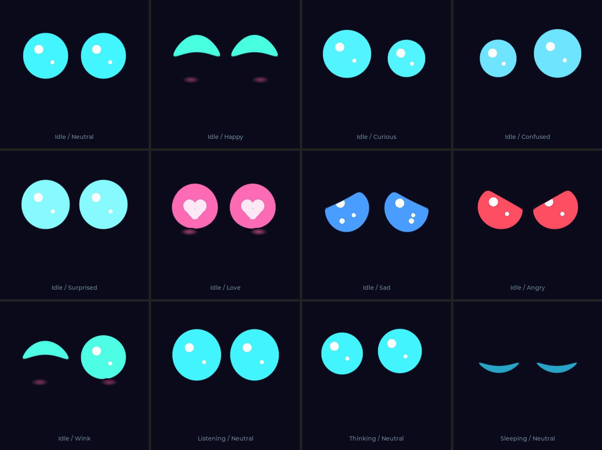
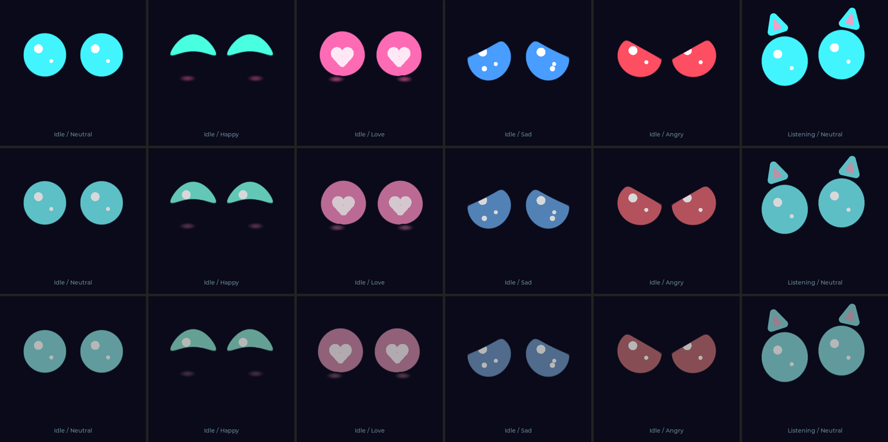
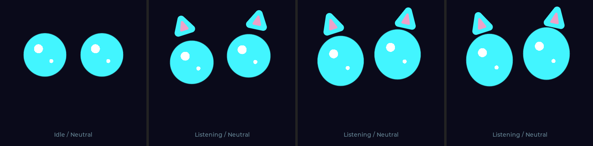
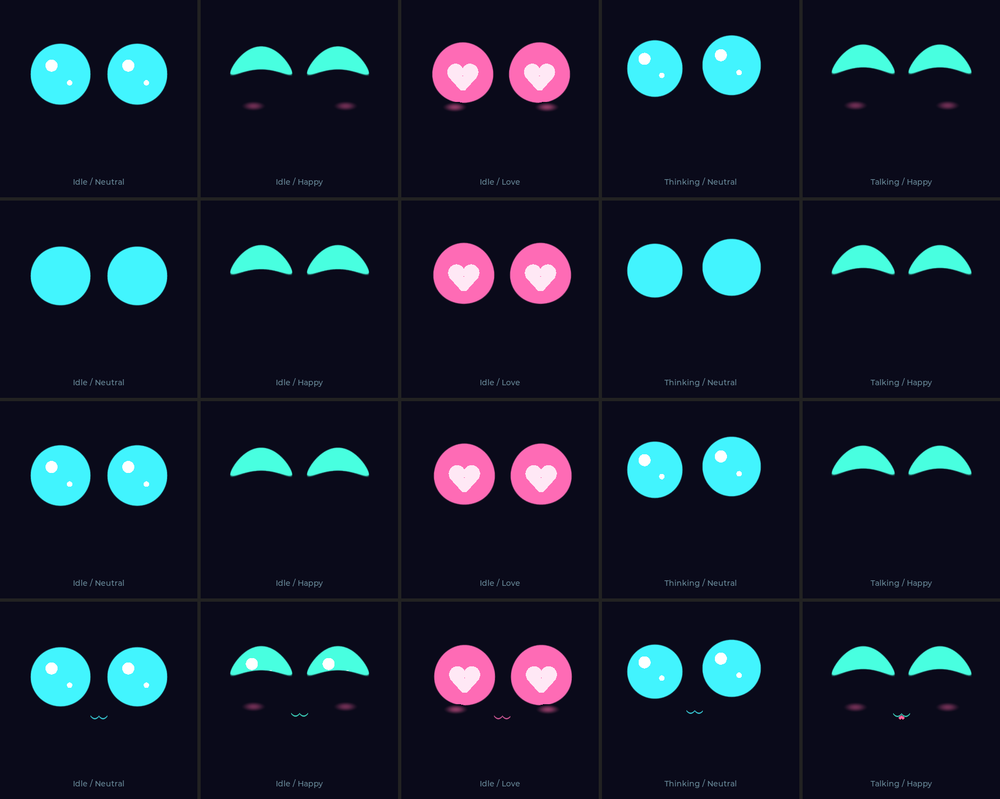

[← 返回 README](../README.md) · [开发路线](roadmap.md) · [改造方案](face-animation-redesign.md)

# Phase 2: 猫脸表情系统 - "让猫有表情"

Phase 2 经历了三次迭代：
- **v1（2026-04-07）**：6 个离散表情 + `lv_anim` 定长插值。
- **v2（2026-10-20）**：Mood × Activity 解耦 + 阻尼弹簧 + LVGL 图元眼睑遮罩（~35fps）。
- **v3（2026-10-21，当前版本）**：**圆润大眼高光引擎 + 单遍解析式 SDF 光栅化 + 9 种情绪 + 待机小剧场 + 83fps 零撕裂 DMA 双缓冲管线**。

- [x] 圆润萌宠大眼风格：100% 纯净无条纹实心抗锯齿圆眼 + 大小双圆高光点 + 柔和渐变粉腮红 + 情绪色彩弹簧
- [x] 9 种情绪（`CatMood`）× 5 种对话状态（`CatActivity`）正交组合
- [x] 中心线抛物线弯曲（`bend`）与圆角眼睑（`smax/smin`）：饱满圆润的弯月笑眼 `∩ ∩` 与柔和安睡弧线 `︶ ︶`
- [x] 物理与次级动作：体积守恒挤压拉伸、扫视联动微眨、速度惯性斜切、滞后双圆高光（Secondary Motion）
- [x] 待机自主小剧场（Idle Micro-Clips）：左右张望、一大一小圆眼好奇打量、眯眼笑、警觉竖眼、犯困钓鱼猛醒
- [x] 音频双包络驱动：说话时提取音节起音拍点（Syllable Onset Beat）驱动眼睛弹性跳跃
- [x] 触摸连击与打断情绪升级：连摸触发害羞爱心眼 `Love`，狂戳或反复打断触发傲娇生气 `Angry`
- [x] 83fps 高帧率管线：片上 DMA SRAM 双缓冲 + `on_color_trans_done` 硬件 DMA 中断同步 + 16 级 LUT 扫描线直写 + CST816 中断按需读触摸
- [ ] 利用 QMI8658 陀螺仪：摇晃板子触发晕眩表情（留到 Phase 6；本板 IMU 无应答）

## 1. 情绪与状态模型（Mood × Activity）

**Activity（对话状态，由 `main.cpp` 状态机决定）**：
`Idle` / `Listening` / `Thinking` / `Talking` / `Sleeping`

**Mood（9 种情绪，定义眼型、动态修饰与赛博荧光色）**：

| 枚举 | 名称 | 荧光色 | 视觉造型与动态特征 | 触发方式 |
|------|------|--------|--------------------|----------|
| 0 `MOOD_NEUTRAL` | Neutral（平静） | `#42F5FF` 冰青 | 圆溜溜的大圆眼（`106×106`）+ 大小双圆高光点 + 待机小剧场 | 默认状态 |
| 1 `MOOD_HAPPY` | Happy（开心） | `#48FFE0` 薄荷青 | 中心线上拱（`bend=+28`）形成饱满圆头弯月 `∩ ∩` + 柔和椭圆粉腮红 | 轻点 1 下 / 后端 `happy` |
| 2 `MOOD_CURIOUS` | Curious（好奇） | `#52F6FF` 天青 | 左眼放大成大圆（`118×118`）、右眼缩小成小圆（`90×90`），一大一小歪头好奇打量 | 后端 `thinking` / `curious` |
| 3 `MOOD_CONFUSED` | Confused（困惑） | `#70E4FF` 浅蓝青 | 左眼小圆（`88×88`）偏下、右眼大圆（`116×116`）偏上 + 反向慢速上下晃动 | 请求报错（非超时） |
| 4 `MOOD_SURPRISED` | Surprised（惊讶） | `#88FAFF` 电光青白 | 超大圆眼睛（`124×124`）圆鼓鼓放大上提 | 说话被打断 / 刚睡醒脉冲 |
| 5 `MOOD_LOVE` | Love（害羞/喜爱） | `#FF6BB5` 甜粉 | 粉嫩大圆眼 + **眼内饱满发光白心 `♥`** + 柔和粉腮红 + 左右害羞轻晃 | 连续轻点抚摸 2~4 下 |
| 6 `MOOD_SAD` | Sad（委屈/难过） | `#489EFF` 蔚蓝 | 圆润八字下垂眼 `/ \`（`smax` 圆角过渡）+ **眼底晃动圆泪珠高光** + 抽泣微起伏 | 请求超时 / 无 WiFi |
| 7 `MOOD_ANGRY` | Angry（傲娇/生气） | `#FF4E62` 珊瑚红 | 奶凶圆眼（底部保持半圆、上眼睑向内压低 `\ /`）+ 110ms 高频微幅颤抖 | 连续戳 ≥5 下 / 15s 内反复打断说话 |
| 8 `MOOD_WINK` | Wink（俏皮眨单眼） | `#4EFFE5` 青绿 | 左眼弯成圆头拱弧 `∩`，右眼圆溜溜大圆眼 + 柔和粉腮红 | 轻点抚摸时 30% 概率随机触发 |

### 配色柔化

上表是设计用的原始色。实际显示时，所有颜色都会再经过一次柔化（`CatFace::setPalette()` / `_soft()`）：先把颜色往它自己的亮度灰拉，降低饱和度，再整体乘一个亮度系数。眼睛、高光、爱心、泪珠、腮红、内耳、小嘴都走这一步，所以各情绪之间的色彩关系保持不变。

当前默认：**饱和度 65%、亮度 85%**，屏幕背光 **35%**（`Display_ST77916.cpp` 的 `LCD_Backlight`，原为 50%）。原始荧光色对宝宝来说太刺眼，2026-10-24 在真机上对比三档后选定。

真机上可以用串口命令 `palette <饱和度%> <亮度%>` 和 `bl <背光%>` 实时调整，确认后再改默认值（`cat_face.h` 的 `_sat` / `_val`，以及 `main.cpp` 的 `_reqSat` / `_reqVal`）。

## 2. 9 维参数化姿态与物理动画引擎

每只眼睛由 9 个浮点参数描述，全部由独立阻尼弹簧（`CatFace::Spring`，隐式欧拉 + ≤8ms 子步积分）驱动：

| 参数 | 含义 | 弹簧频率 / 阻尼 |
|------|------|-----------------|
| `P_DX`, `P_DY` | 眼睛中心相对基准位置 `(112/248, 136)` 的偏移 | `5.2Hz` / `0.68` |
| `P_W`, `P_H` | 眼睛宽高（欠阻尼设计，切换时自带 Q 弹过冲回弹） | `4.8Hz` / `0.56` |
| `P_CORNER` | 圆角率 `0.15`（硬朗方眼）~ `0.48`（圆润胶囊） | `5.0Hz` / `0.75` |
| `P_TOP_LID` | 上眼睑遮挡比例 `0..1` | `6.5Hz` / `0.82` |
| `P_TOP_TILT` | 上眼睑倾斜：正值压低内眼角 `\ /`，负值压低外眼角 `/ \` | `5.5Hz` / `0.75` |
| `P_BOT_LID` | 下眼睑上推比例 `0..1` | `6.0Hz` / `0.78` |
| `P_BEND` | 中心线抛物线弯曲像素：正值上拱 `∩`，负值下弯 `︶` | `5.2Hz` / `0.60` |

此外还有 7 个全局弹簧：视线 `_gazeX/_gazeY`（`11Hz`）、滞后高光 `_hlX/_hlY`（`6.2Hz`，欠阻尼 `0.58` 产生次级跟随动作）、荧光颜色 `_colR/_colG/_colB`（`4Hz`）、腮红透明度 `_blushOpa` 与小嘴开合 `_mouthOpen`。右眼弹簧频率统一乘以 `1.06`，使双眼运动天然带有微妙先后差。

### 动态叠加层
1. **体积守恒挤压拉伸（Squash & Stretch）**：眨眼、说话弹跳、手指按压导致高度 `h` 压缩时，宽度 `w` 自动按比例横向延展，保持视觉面积感。
2. **扫视联动微眨与速度斜切（Saccadic Blink & Velocity Skew）**：视线跳变距离 `> 13px` 时自动触发一次 50% 深度的快速半眨眼，并根据水平速度 `_gazeX.v` 施加运动惯性斜切。
3. **双包络音节拍点检测（Syllable Onset Beat）**：说话时同时维护快包络（15ms 起音 / 70ms 释放）与慢包络（120ms 起音 / 220ms 释放），用 `fast - slow` 提取每个字的起音瞬态拍点，驱动眼睛随每个字向上弹性拱起。
4. **待机自主小剧场（Idle Micro-Clips）**：在 `Idle + Neutral` 下每 4~8 秒自动演出一段微表情剧本：
   - `CLIP_LOOK_AROUND`：快速左看 → 停顿 → 右看 → 回正
   - `CLIP_CURIOUS_PEEK`：单侧挑眉微眯 + 歪头打量 1.6s
   - `CLIP_HAPPY_SQUINT`：满足地眯起弯月笑眼 1.8s
   - `CLIP_ALERT_PERK`：先微缩蓄力再竖起耳朵般睁大双眼向上看
   - `CLIP_DROWSY_NOD`（困倦度 `>0.25` 时）：眼皮沉重缓慢点头下坠 → 猛然惊醒睁眼

## 3. 单遍解析式 SDF 光栅化与 83fps 渲染管线

`CatFace::_rasterizeEye()` 不调用任何 LVGL 几何图元，直接在 `LV_EVENT_DRAW_MAIN` 中对 `layer->draw_buf` 执行单遍列扫描：

1. **预计算 `lut565[3][16]` 查找表**：每只眼在绘制前预计算 `3 行 CRT 扫描线亮度（64% / 100% / 88%）× 16 级抗锯齿覆盖度（含外圈 1.4px 荧光晕）` 的 RGB565 颜色表。
2. **按列解析求交**：对每一列 `x`，直接算出圆角方框、上下斜切眼睑、抛物线弯曲中心线合成后的精确上下边界 `[yTop, yBot]` 与法线斜率修正因子。
3. **上下边缘查表 + 内部实心跨度零浮点直写**：上下各 2~3px 抗锯齿边缘查 `lut565[s][covIdx]`；中间实心区域直接按指针步进写入 `lut565[s][15]`，再按需叠加高光块、爱心或动态泪波。
4. **左右眼独立局部脏区**：将腮红并入左右眼各自的窄包围盒，每帧只刷新两块独立小区域，避免横跨全屏的无效刷新。

配合底层驱动优化（片上 DMA SRAM 双缓冲、`LV_USE_OS = LV_OS_NONE`、400kHz I2C + CST816 中断按需读触摸），真机实测全状态稳定 **70 ~ 83.3 fps**。

### 倾听（录音中）

录音时要同时表达"它在认真听"和"现在正在录音"两件事：

- **歪头**：进入录音时随机选一侧，那侧眼睛下沉 8px、另一侧抬高 8px，双眼往该侧偏 5px。
- **竖起猫耳**：两只圆角三角猫耳（外圈是眼睛的颜色，内耳浅粉色）带回弹地弹出，跟着歪头和眼睛位置走。声音越大耳朵竖得越高；每次开口（快包络减慢包络得到的起音）时，两只耳朵先后往外抖一下。录音结束后耳朵收回。
- **跟着声音变大**：眼睛高度最多放大约 20%，宽度约 9%。为了给耳朵留空间，录音时眼睛整体下移 8px。
- **灵敏度用对数刻度**：麦克风 RMS 15 → 0，150 → 0.5，1500 → 1。实测安静约 5，小声说话 50~150，正常说话几百以上，所以小声也有明显反应。

耳朵用"三角形距离场 − 圆角半径"逐像素绘制：每行先算出覆盖范围，三条边的距离沿 x 增量更新，只有角落才做开方。每帧按实际外框标脏。录音时真机约 56fps，其余状态保持 83fps。

## 4. 装饰层（`setDecor`）

`DECOR_HIGHLIGHT = 1`（次级跟随高光块）、`DECOR_BLUSH = 2`（赛博斜线腮红 `///`）、`DECOR_MOUTH = 4`（小嘴 `ω`）。默认开启 `DECOR_HIGHLIGHT | DECOR_BLUSH`（掩码 `3`），串口发送 `decor <0..7>` 或模拟器按 `D` 键可实时切换。

从上到下依次为：`高光+腮红（默认）` / `无装饰` / `仅高光` / `全部（高光+腮红+小嘴）`。

## 5. 对话与触摸交互（`main.cpp`）

手势在**松手时**判定（`detectGestures()`）：

- **拖动**：按住期间手指移动超过 20px。只让眼睛跟随手指，不触发轻点或长按。
- **长按**：按住 ≥600ms 且没有拖动，松手那一刻触发。之所以不在按住满 600ms 时立即触发，是因为慢慢起步的拖动在前几百毫秒和长按完全一样，只有看完整个按压过程才分得清。
- **轻点**：其余情况。
- **连击**：间隔 <3.5s 的轻点算同一次连击。

| 状态 | 轻点（Tap） | 长按（≥600ms，松手触发） |
|------|-------------|----------------|
| Idle | 第 1 下：`Happy`（30% 概率 `Wink`） 连续 2~4 下：`Love` 害羞爱心眼 连续 ≥5 下：`Angry` 傲娇生气，继续戳保持生气；停手 3.5s 后先 `Sad` 委屈 1.8s 再恢复 | 开始录音进入 `Listening`（无 WiFi 则脉冲 `Sad`） |
| Listening | 提前结束录音 → `Thinking` | 取消录音 → `Idle` |
| Thinking | — | 取消当前云端请求 → `Idle` |
| Talking | 打断播放 → `Idle`（首次 `Surprised`，15s 内再次打断触发 `Angry`） | 打断播放并直接重新开始录音 `Listening` |
| Sleeping | 唤醒（`Surprised` 脉冲 + 右眼延迟 220ms 睁开）→ `Idle` | 唤醒并直接进入 `Listening` |

## 6. 关键文件

| 文件 | 用途 |
|------|------|
| `src/cat_face.h` | `CatActivity` / `CatMood`（9种）/ `DECOR_*` 枚举，`Pose`（9参数）与 `CatFace` 声明 |
| `src/cat_face.cpp` | 姿态与配色表、弹簧物理、扫视/眨眼/待机小剧场调度、LUT 加速扫描线 SDF 光栅化 |
| `src/main.cpp` | 对话状态机、触摸连击与打断情绪分派、串口调试命令 |
| `lib/waveshare/LVGL_Driver.cpp` | 片上 DMA SRAM 绘图双缓冲、CST816 中断按需读取、12ms 帧率节奏控制 |
