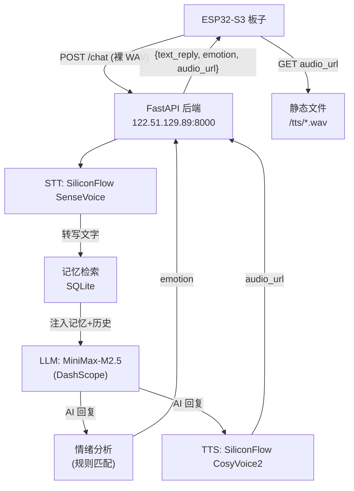

[← 返回 README](../README.md) · [开发路线](roadmap.md)

# Phase 5: 后端服务 - "给猫装上大脑" (已完成 2026-04-11)

**目标**：在腾讯云服务器上搭建 Python 后端，ESP32 作为薄客户端只调一个接口

**服务器**：腾讯云 `122.51.129.89`，Ubuntu 24.04 LTS，Python 3.12，部署路径 `/opt/cybercat/`



- [x] **`POST /chat` 统一接口**：ESP32 POST 裸 WAV → 后端串联 STT→LLM→TTS → 返回 JSON（`text_reply` + `emotion` + `audio_url`）
- [x] **对话服务**：猫猫人设 system prompt（"赛博喵"），MiniMax-M2.5 via DashScope，注入记忆和对话历史
- [x] **情绪分析**：规则匹配（`happy`/`thinking`/`neutral`），后端 emotion 字段驱动猫脸表情
- [x] **记忆模块**：SQLite 短期对话历史（最近 10 轮）+ LLM 定期提取长期记忆摘要
- [x] **TTS 音频服务**：WAV 缓存为静态文件，UUID 文件名直链，1 小时自动清理
- [x] **部署**：uvicorn + systemd 守护进程（`cybercat-backend.service`），开机自启
- [x] **设备端对接**：`#ifdef BACKEND_URL` 条件编译，`secrets.h` 注释掉即回退 Phase 4 直连模式

**HTTP 合约**：

```
POST /chat
Content-Type: audio/wav
X-Session-ID: <ESP32 MAC 地址>
Body: 裸 WAV 字节（44 字节头 + 16-bit PCM, 16kHz mono）

→ 200 OK
{
  "text_reply": "喵～听到了听到了！有什么想聊的吗？🐱",
  "emotion": "happy",
  "audio_url": "http://122.51.129.89:8000/tts/b9544fd9...1b.wav"
}
```

**emotion 可选值**：

| 值 | 猫脸表情 | 触发条件 |
|----|----------|----------|
| `happy` | `CAT_HAPPY` 眯眼 | 回复含 `!` `~` `哈哈` `喵喵` 等 |
| `thinking` | `CAT_THINKING` 沉思 | 回复含 `嗯` `也许` `可能` `让我想想` 等 |
| `neutral` | `CAT_NEUTRAL` | 默认 |
| `talking` | `CAT_TALKING` 律动 | fallback |

**技术栈**：

| 层 | 选型 |
|----|------|
| Web 框架 | FastAPI + uvicorn |
| STT | SiliconFlow `FunAudioLLM/SenseVoiceSmall` |
| LLM | MiniMax-M2.5（阿里云 DashScope OpenAI 兼容接口）|
| TTS | SiliconFlow `FunAudioLLM/CosyVoice2-0.5B:anna`（温柔女声）|
| 记忆 | SQLite（`sessions` 短期 + `long_term_memory` 长期）|

**记忆管理策略**：
- 短期记忆：每轮对话自动保存到 `sessions` 表，LLM 注入最近 10 轮历史
- 长期记忆：每 5 轮对话用 LLM 从历史中提取关键信息（用户名字、喜好、重要事件），更新 `long_term_memory` 表
- LLM system prompt 自动注入记忆摘要：`[关于用户的记忆：{summary}]`

**设备端对接（`cloud_client.cpp`）**：

`_sttWorkerTask` 通过 `#ifdef BACKEND_URL` 分支：
1. 在 PSRAM 中拼装 44 字节 WAV 头 + PCM，POST 到 `{BACKEND_URL}/chat`（plain HTTP，`WiFiClient`）
2. 解析 JSON 三字段，`emotion` 存入 `_emotion[32]`，`audio_url` 存入 `_audioUrl[256]`
3. `_doTts()` 检测到 `_audioUrl` 非空时，调用 `_downloadAndPlayWav()` 下载并播放
4. `main.cpp` 中 `emotionToMood()` 将 emotion 映射为猫脸情绪（`CatMood`），传入 `enterTalking(reply, mood)`

**端到端实测日志**：
```
[Cloud] Backend POST http://122.51.129.89:8000/chat (143084 bytes WAV)
[Cloud] Backend response: {"text_reply":"喵~听到了！","emotion":"happy","audio_url":"http://..."}
[Cloud] Downloading TTS WAV: http://122.51.129.89:8000/tts/b9544fd9...wav
[Cloud] TTS WAV downloaded 125532 bytes
[ES8311] play: 16000Hz 1ch 16bit, 125488 bytes PCM
[ES8311] play loop done in 3823ms
```

**已知限制**：
- Backend 模式下 `[你]` 用户字幕不显示（后端 `/chat` 不单独返回 transcript，只返回 AI 回复），仅显示 `[猫]` AI 回复
- 情绪分析为简单规则匹配，未来可升级为 LLM 分类
- HTTP 明文通信（后端为私有服务器，初期可接受；生产环境需 nginx + TLS）
